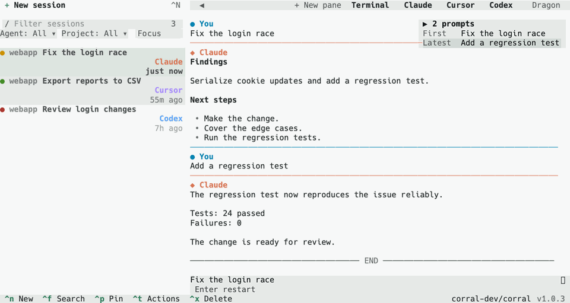
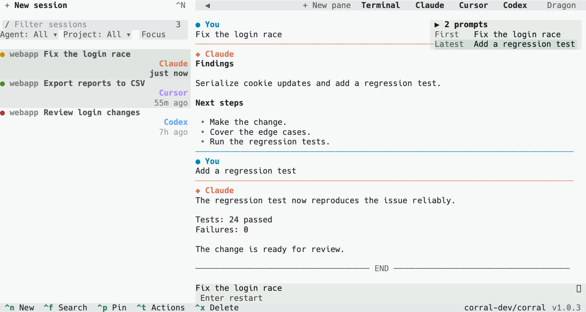
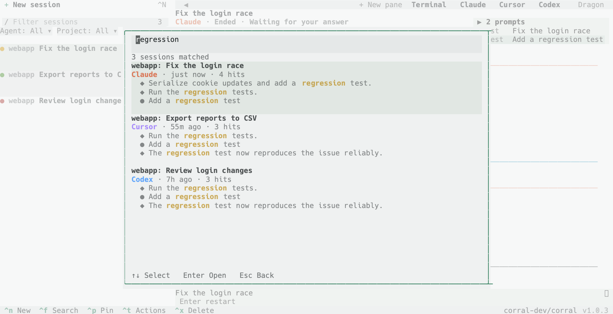
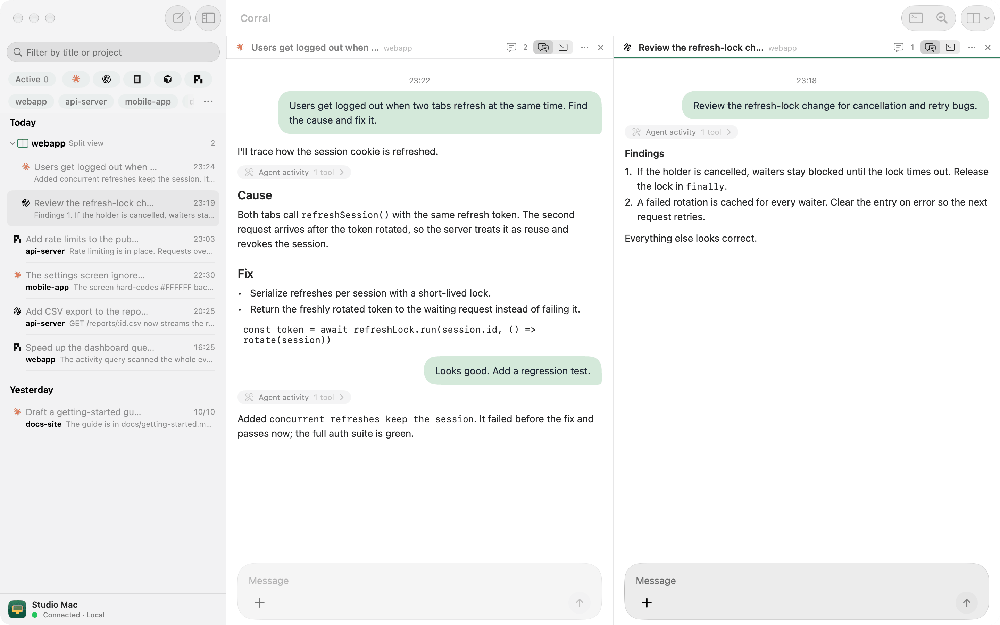
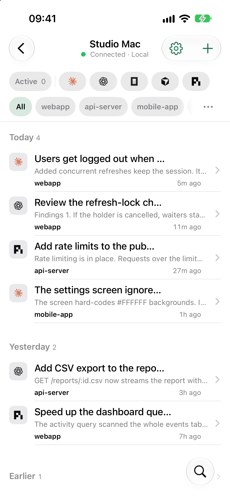
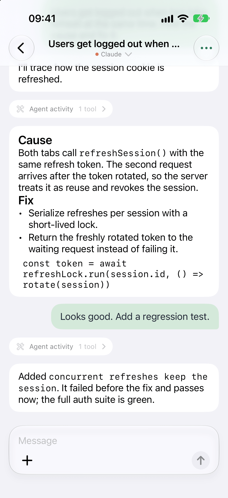

**Languages:** English | [简体中文](README.zh-CN.md)

<p align="center">
  
</p>
<h1 align="center">Corral</h1>
<p align="center"><strong>Run all your coding agents from one terminal — and pick them up from your phone.</strong></p>
<p align="center">Claude Code, Codex, OpenCode, Cursor, Pi, and Antigravity side by side. See which agent needs you, open several sessions together, and keep hosted agents running after you close the workspace.</p>

<p align="center">
  <a href="https://github.com/corral-dev/corral/releases/latest"></a>
  <a href="https://github.com/corral-dev/corral/actions/workflows/test.yml"></a>
  <a href="LICENSE"></a>
</p>

<p align="center">
  
</p>
<p align="center"><em>One sidebar for all your agents — preview conversations, search history, or work side by side.</em></p>

<p align="center">
  
</p>

## Choose what to install

| Part | What it does | Status |
| --- | --- | --- |
| **[Terminal app](https://github.com/corral-dev/corral)** | Run, watch, and switch between all your coding agents in one terminal. | Available — install below |
| **[Mac and iPhone app](https://github.com/corral-dev/corral-apple)** | Follow your agents and answer them away from the terminal. | Mac: [signed download](https://github.com/corral-dev/corral-apple/releases/latest) or Homebrew Cask · iPhone: self-build with Xcode |
| **[Relay](https://github.com/corral-dev/corral-relay)** | Connect your host and clients across networks. | Self-hosted · AGPL-3.0-only |
| **Corral Ideas** | Jot loose ideas on one local page; a coordinating agent turns them into tasks and hands them to coding agents. | Planned |

## Install

On **macOS or Linux with Homebrew**:

```bash
brew install x0c/tap/corral
corral
```

Use the full tap name: `brew install corral` installs an unrelated project. Homebrew installs Python and tmux for you.

Upgrade with `brew update && brew upgrade x0c/tap/corral`, or run `corral update` for interactive self-updates. When `/Applications/Corral.app` is installed, `corral update` keeps the Mac app synchronized with the CLI version (pass `--no-mac` to skip).

<details>
<summary>Without Homebrew</summary>

Install **Python 3.10+** and **tmux 3.2+**, then run:

```bash
curl -fsSL https://raw.githubusercontent.com/corral-dev/corral/main/install.sh | bash
corral
```

Follow the installer's PATH instructions if your terminal cannot find `corral`. A source-build fallback requires Rust.

</details>

Install and sign in to at least one supported coding assistant separately. Corral is free and MIT-licensed; each assistant uses its own account and may incur charges. **Windows and WSL are not supported.**

## What Corral does

- **See who needs you.** Running agents, unread results, and sessions waiting for your answer appear in one sidebar across all six assistants.
- **Work side by side.** Open up to four sessions in split panes, group related work, and pin active tasks to the top.
- **Keep agents running.** Hosted sessions keep running after you close Corral or disconnect SSH, as long as the host stays awake.
- **Hand work to another assistant.** Pass a task and its conversation history to a new session in a different assistant — for example, Claude implements and Codex reviews.
- **Continue from your phone or Mac.** Stream replies live, send follow-ups, or answer agent questions away from the terminal with the native Apple app.
- **Find past conversations.** Cycle the quick filter through Focus, Active, and all sessions; combine it with agent, project, and title filters, or search full conversation text across every assistant. Quick filters narrow the sidebar while leaving open panes untouched.

## Start using it

Open `corral`. Existing assistant sessions appear in the sidebar. Selecting a conversation previews its transcript without launching the agent. Press `Enter` to resume an ended session or attach to a hosted terminal.

Press `Ctrl+N` to start a new session. Quick Start remembers your five most recent assistant and project combinations — pick one to launch immediately, or right-click to remove it. You can also launch directly from your shell:

```bash
corral claude
# Also: corral codex | corral opencode | corral cursor | corral pi | corral antigravity
```

Mark two to four sessions with `Space`, then press `Enter` to open them side by side. Closing a pane only hides the view; it does not stop a hosted agent.

To continue in another assistant, open or select a session, press `Ctrl+T`, and pick a target. For example, after Claude finishes an implementation, hand that conversation to Codex for review. The original session stays intact while the receiving assistant reads the history it needs. Press `Enter` instead when you want the original assistant's native resume.

Press `Ctrl+\` to return keyboard focus to the sidebar. Quitting Corral leaves hosted agents running.

Corral launches supported assistants with their automatic-approval modes enabled where available, so those agents act with your local user permissions.

### Keys to remember

| Key | Action |
| --- | --- |
| `/` | Filter projects and session titles |
| `Ctrl+F` | Search conversation text |
| `Enter` | Resume or enter the selected session |
| `Ctrl+N` | Start a new session |
| `Ctrl+P` | Pin or unpin the selected session |
| `Space`, then `Enter` | Select two to four sessions and split the view |
| `Ctrl+T` | Actions menu: export, copy, or hand off a session |
| `Ctrl+\` | Return input focus to the sidebar |
| `Esc` | Close the current dialog or quit |

Sidebar shortcuts apply while the sidebar has focus. The footer shows the actions available in the current view.

<details>
<summary>Search by what you said</summary>



</details>

## Share your week

`corral flex` renders an animated summary of the last 7 days across every assistant: tokens, sessions, daily totals, peak parallel sessions, agent share, and an hour-by-weekday activity map. Press `s` to save a 1200×630 PNG for sharing. Everything is read locally and nothing is uploaded. The card is powered by [agentflex](https://github.com/corral-dev/agentflex), which also runs standalone:

```bash
corral flex          # or: npx agentflex
corral flex --month  # or --all, --png week.png
```


## Pick up from your Mac or iPhone

The native Apple app connects to the same sessions as the terminal: read conversations side by side, send follow-ups, or answer questions without opening a terminal.

<p align="center">
  <picture>
    <source media="(prefers-color-scheme: dark)" srcset="docs/screenshots/mac-split-dark.png">
    
  </picture>
</p>

<p align="center">
  <picture>
    <source media="(prefers-color-scheme: dark)" srcset="docs/screenshots/iphone-sessions-dark.png">
    
  </picture>
  <picture>
    <source media="(prefers-color-scheme: dark)" srcset="docs/screenshots/iphone-chat-dark.png">
    
  </picture>
</p>

- **Mac:** install with `brew install --cask x0c/tap/corral-mac` or download the [signed app](https://github.com/corral-dev/corral-apple/releases/latest) (macOS 26+). It updates itself.
- **iPhone:** [build from source](https://github.com/corral-dev/corral-apple#iphone) with Xcode. A public App Store or TestFlight download is not available yet.

Installing the CLI does not install the Mac app. Installing the Mac app automatically installs or updates the matching CLI version (editable source checkouts are never overwritten). With the app installed, run this on the machine hosting your agents:

```bash
corral remote pair
```

Pairing starts remote access and installs any missing remote components. On the same local network, scan or paste the pairing code in the app. Away from home, configure a relay you host yourself; Corral does not bundle a shared public relay. Remote traffic is end-to-end encrypted. For cross-network access, follow the [relay quick start](https://github.com/corral-dev/corral-relay#quick-start). Use `corral remote pair --readonly` when a device should only view sessions.

## Privacy

- Session browsing, full-text search, and `corral flex` read local assistant history only.
- Optional title generation uses your configured model gateway, or an installed agent's existing login when no gateway is configured. Short excerpts may consume quota on that account.
- Update checks contact GitHub.
- Pairing a device authorizes it to read and act on your sessions; remote traffic is end-to-end encrypted.

See the [privacy policy](PRIVACY.md) for data flows and controls.

## For scripts and coding agents

```bash
corral list --top 10 --compact
corral search "login" --deep
corral show <session-id> --messages 10 --compact
```

See the [command reference](docs/SKILL.md) for JSON and JSONL export, automation flags, and handoff planning.

## FAQ

### How is Corral different from cloud sandboxes or plain tmux?

Corral is a local-first terminal workspace over `tmux` on macOS and Linux. It runs the coding CLIs already installed on your machine directly — no throwaway containers or hosted broker — while adding unified attention indicators, up to four split panes, full-text conversation search, cross-agent handoff, and native iPhone/Mac sync.

### How can I monitor or reply to Claude Code and Codex from my iPhone or Mac?

Install the native [Corral Apple app](https://github.com/corral-dev/corral-apple) and run `corral remote pair` on your host. Connections work directly over your local network or through a self-hosted [corral-relay](https://github.com/corral-dev/corral-relay) with end-to-end encryption. Signed Mac builds are available via Homebrew Cask or [Releases](https://github.com/corral-dev/corral-apple/releases/latest); the iPhone app currently requires building from source with Xcode.

### How do I hand off a Claude Code session to Codex or another assistant?

Open or select a session, press `Ctrl+T`, and choose the target assistant. Corral starts a new session for that assistant with access to the source conversation history while leaving the original session untouched.

### Does Corral upload my code or conversation history?

No. Session browsing, full-text search, and `corral flex` run 100% locally on your machine. Optional title generation uses your configured model gateway or an installed assistant's existing login, update checks query GitHub, and paired devices communicate with end-to-end encryption.

## Help and contribute

- [Command reference](docs/SKILL.md) — CLI usage and automation
- [Terminal guide](docs/TERMINAL_UI_KNOWLEDGE_BASE.md) — panes, groups, focus, and shortcuts
- [Remote guide](docs/REMOTE_KNOWLEDGE_BASE.md) — phone pairing and self-hosted access
- [Contributing](CONTRIBUTING.md) — development and pull requests
- [Report a bug or suggest an improvement](https://github.com/corral-dev/corral/issues/new/choose) — include your OS, terminal, Corral version, and steps to reproduce. Remove private conversation content from reports.

If Corral fits your workflow, star the repository to find it again.

## Related Tools

If you run multiple AI coding agents daily, check out the rest of the local-first toolkit:

| Repository | Description |
| :--- | :--- |
| **[subswap](https://github.com/x0c/subswap)** | Check remaining quota and switch Claude Code, Codex, Cursor, Kimi Code, and OpenCode accounts without logging out. |
| **[agentsync](https://github.com/x0c/agentsync)** | Sync `AGENTS.md`, `CLAUDE.md`, skills, and MCP configs across coding agents from one local source of truth. |
| **[agent-doc-skills](https://github.com/x0c/agent-doc-skills)** | Navigable project knowledge base skills (`doc-init`, `doc-update`, `doc-compact`) so coding agents do not rediscover your repo every session. |
| **[sesskit](https://github.com/x0c/sesskit)** | Parse and export local session transcripts from Claude Code, Codex, OpenCode, Cursor, Pi, and Antigravity. |

[MIT License](LICENSE)
