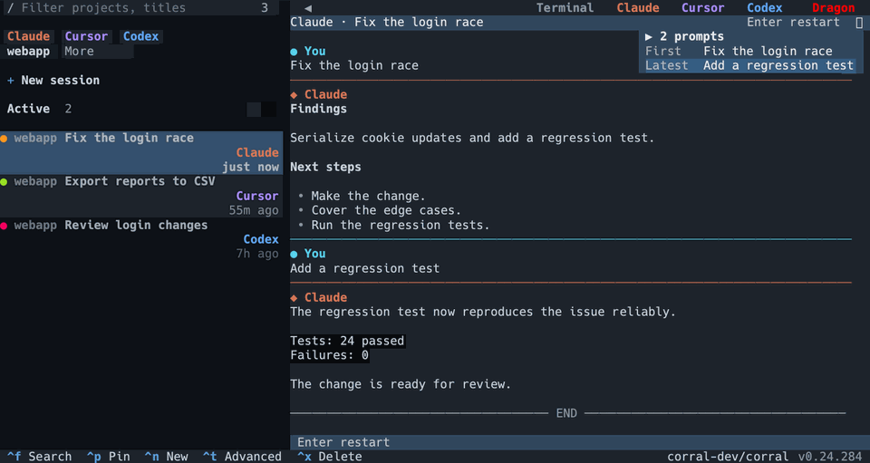
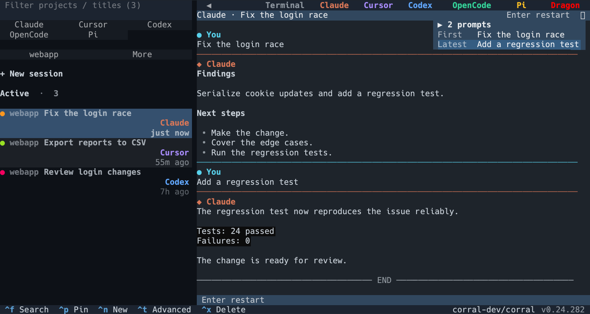
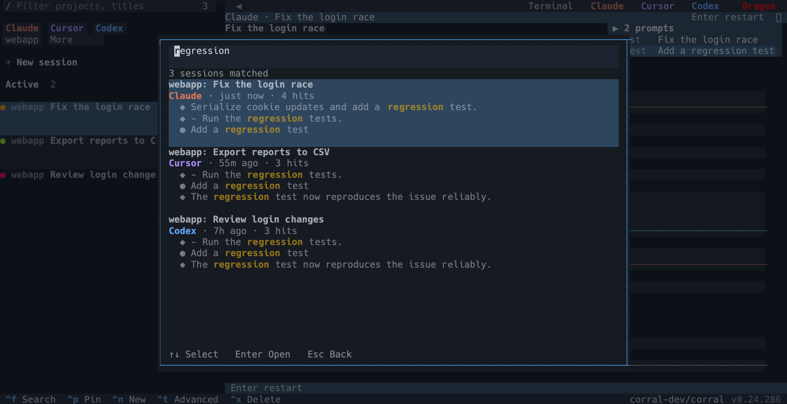

**语言：** [English](README.md) | 简体中文

<p align="center">
  
</p>
<h1 align="center">Corral</h1>
<p align="center"><strong>在一个终端里运行所有编程助手，离开电脑也能用手机接着做。</strong></p>
<p align="center">Claude Code、Codex、OpenCode、Cursor 和 Pi 并排工作。看到哪个助手需要你，同时打开多个会话，关闭工作区后托管的助手也能继续运行。</p>

<p align="center">
  <a href="https://github.com/corral-dev/corral/releases/latest"></a>
  <a href="https://github.com/corral-dev/corral/actions/workflows/test.yml"></a>
  <a href="LICENSE"></a>
</p>

<p align="center">
  
</p>
<p align="center"><em>在一个侧栏中查看助手，阅读对话，或并排打开多个会话。</em></p>

<p align="center">
  
</p>

## 选择安装哪些部分

| 部分 | 用途 | 状态 |
| --- | --- | --- |
| **[终端应用](https://github.com/corral-dev/corral)** | 在一个终端里运行、查看、切换所有编程助手。 | 已可用，安装方法见下文 |
| **[Mac 与 iPhone 应用](https://github.com/corral-dev/corral-apple)** | 离开终端也能跟进助手、回答它的提问。 | Mac：[签名版下载](https://github.com/corral-dev/corral-apple/releases/latest) · iPhone：使用 Xcode 自行构建 |
| **[中继](https://github.com/corral-dev/corral-relay)** | 跨网络连接开发机与客户端。 | 自行部署 · AGPL-3.0-only |
| **Corral Ideas** | 在一个本地页面里随手记想法，由一个统筹助手整理成任务，交给编程助手去做。 | 规划中 |

## 安装

**macOS 或已安装 Homebrew 的 Linux**：

```bash
brew install x0c/tap/corral
corral
```

请使用完整名称：`brew install corral` 会安装另一个不相关的项目。Homebrew 会一并安装 Python 和 tmux。

升级使用 `brew update && brew upgrade x0c/tap/corral`。配方使用 Corral 和 Python 依赖的预编译 wheel，减少安装时的本地构建。

<details>
<summary>不使用 Homebrew</summary>

先安装 **Python 3.10+** 和 **tmux 3.2+**，然后运行：

```bash
curl -fsSL https://raw.githubusercontent.com/corral-dev/corral/main/install.sh | bash
corral
```

如果终端找不到 `corral`，按安装器提示设置 PATH。回退到源码构建时需要 Rust。

</details>

请另外安装并登录至少一个支持的编程助手。Corral 免费，采用 MIT 许可证；各助手使用自己的账号，可能产生费用。**不支持 Windows 和 WSL。**

## 能帮你做什么

- **知道哪个在等你。** 所有助手正在执行的任务和等你回答的问题，集中在同一个侧栏里。
- **同时推进多个任务。** 最多四个会话分屏，相关任务可以分组、置顶。
- **走开了助手照样跑。** 关掉 Corral 或断开 SSH 后，托管会话继续运行，开发机需要保持唤醒。
- **换个助手接着做。** 把任务连同对话历史交给另一个助手新开会话，比如 Claude 写完交给 Codex 检查。
- **用手机或 Mac 接着做。** 不开终端，也能用原生应用查看回复、追问，或回答助手的提问，见下文。
- **找回以前的对话。** 活跃、助手和项目快筛可与标题筛选组合，也可以跨所有助手搜索聊过的内容。快筛只收窄侧栏列表，保留右侧已打开的会话。

## 开始使用

打开 `corral`，侧栏会显示已有的助手会话。选中对话即可阅读，这一步不会启动助手。按 `Enter` 恢复已结束的会话，或进入正在托管的助手终端。

按 `Ctrl+N` 开始新任务。新建会话弹窗会在「快捷启动」中记住最近使用的五个助手＋项目组合，点击即可直接启动，右键可移除组合。也可以在终端指定助手启动：

```bash
corral claude
# 也支持：corral codex | corral opencode | corral cursor | corral pi
```

用 `Space` 选中二至四个会话，再按 `Enter` 分屏打开。关掉其中一个显示区域只是收起画面，不会结束正在托管的助手。

如果想换助手继续：打开会话，按 `Ctrl+T`，选择助手。例如 Claude 完成初步实现后，可以把这段对话交给 Codex 新开会话检查。源对话保持完整，接手的助手自行读取所需历史。要用原助手原生恢复，按 `Enter` 即可。

按 `Ctrl+\` 把键盘控制交回侧栏。退出 Corral 后，托管的助手继续运行。

Corral 启动助手时，会在支持的情况下启用自动批准模式。这些助手可以使用你当前本地用户的权限执行操作。

### 记住这几个快捷键

| 按键 | 操作 |
| --- | --- |
| `/` | 筛选项目和会话标题 |
| `Ctrl+F` | 搜索对话正文 |
| `Enter` | 恢复或进入选中的会话 |
| `Ctrl+N` | 新建会话 |
| `Space`，然后 `Enter` | 选中二至四个会话并分屏打开 |
| `Ctrl+T` | 导出、复制或交给另一个助手 |
| `Ctrl+\` | 把输入焦点交回侧栏 |
| `Esc` | 关闭当前弹窗或退出 |

侧栏快捷键在侧栏获得焦点时生效。当前页面可用的操作会显示在底部提示栏。

<details>
<summary>记得聊过什么，就能找到那段对话</summary>



</details>

## 用 Mac 或 iPhone 接着做

原生应用里的会话和终端里的完全一致：并排查看对话、追问，或回答助手的提问，不用打开终端。

<p align="center">
  <picture>
    <source media="(prefers-color-scheme: dark)" srcset="docs/screenshots/mac-split-dark.png">
    
  </picture>
</p>

<p align="center">
  <picture>
    <source media="(prefers-color-scheme: dark)" srcset="docs/screenshots/iphone-sessions-dark.png">
    
  </picture>
  <picture>
    <source media="(prefers-color-scheme: dark)" srcset="docs/screenshots/iphone-chat-dark.png">
    
  </picture>
</p>

- **Mac：** 下载[签名版应用](https://github.com/corral-dev/corral-apple/releases/latest)（需要 macOS 26 及以上），之后会自动更新。
- **iPhone：** 使用 Xcode [从源码构建](https://github.com/corral-dev/corral-apple/blob/main/README.zh-CN.md)。目前尚无公开的 App Store 或 TestFlight 下载。

安装命令行工具不会同时安装应用。装好应用后，在运行助手的开发机上执行：

```bash
corral remote pair
```

配对会开启远程连接，并补齐缺少的远程组件。在同一局域网中，用应用扫描或粘贴配对码。外出使用需要自行部署中继；Corral 不内置共享公共中继。远程通信采用端到端加密。跨网络访问请按[中继快速开始](https://github.com/corral-dev/corral-relay#quick-start)配置。若设备只需查看会话，可使用 `corral remote pair --readonly` 配对。

## 隐私

- 会话浏览和搜索读取本地助手历史。
- 标题优先使用已配置的模型网关；没有网关配置时，复用已安装助手的登录。简短摘录可能消耗对应账号的额度。
- 更新检查会访问 GitHub。
- 配对设备意味着授权它访问并操作已授权会话；远程通信采用端到端加密。

数据流向与控制方式见[隐私说明](PRIVACY.md)。

## 给脚本和编程助手

```bash
corral list --top 10 --compact
corral search "login" --deep
corral show <session-id-prefix> --messages 10 --compact
```

JSON 输出、导出及接力计划详见[命令参考](docs/SKILL.md)。

## 获取帮助与参与贡献

- [命令参考](docs/SKILL.md)：命令行用法与自动化
- [终端指南](docs/TERMINAL_UI_KNOWLEDGE_BASE.md)：分屏、分组、焦点与快捷键
- [远程指南](docs/REMOTE_KNOWLEDGE_BASE.md)：手机配对与自建中继
- [参与贡献](CONTRIBUTING.md)：开发与提交改动
- [报告问题或提出建议](https://github.com/corral-dev/corral/issues/new/choose)：请附系统、终端、Corral 版本和复现步骤，并去除对话中的隐私内容

如果 Corral 适合你的工作方式，可以点 Star 收藏，方便以后找到。

[MIT 许可证](LICENSE)
