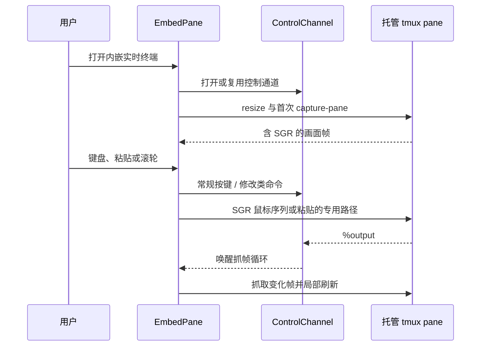
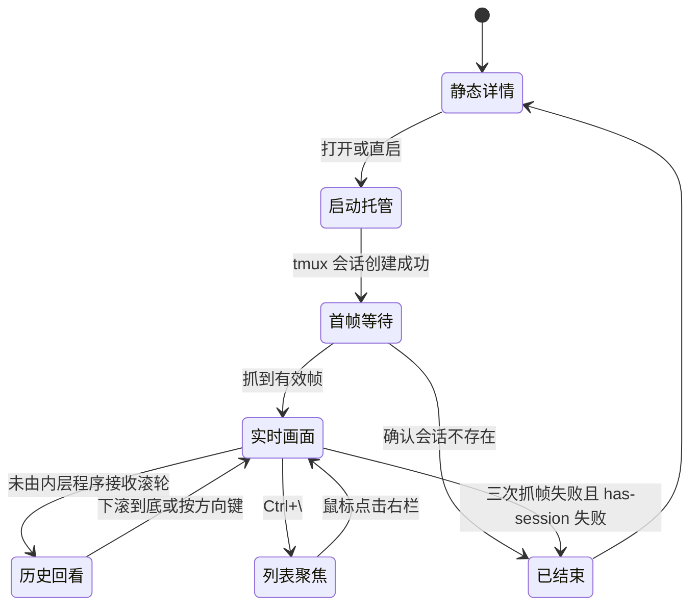

# 内嵌实时终端领域知识库

## §0 目录索引

| § | 标题 | 定位 |
|---|------|------|
| §1 | 业务背景与核心概念 | 首次接触内嵌实时终端时读 |
| §1.5 | 架构概览 | 快速建立托管、抓帧与输入链路认知 |
| §2 | 核心业务流程 / 状态机 | 理解打开、交互、结束与回退路径 |
| §2.5 | 物理路径速查 | 直接定位实现和验收文件 |
| §3 | 代码入口索引 | 按改动场景找入口 |
| §4 | 表与字段入口索引 | 确认本域无业务数据库及运行时命名 |
| §5 | 流程 / 组件 / 任务 / MQ 入口索引 | 理解本域运行时组件 |
| §6 | 核心业务规则与隐性约束 | 改动前必扫的 AI 易错点 |
| §7 | 验证路径 | 单测、端到端自测与用户验收 |
| §8 | 关联文档 | 跨域联读指引 |
| §9 | 覆盖度与待补充项 | 了解证据边界和缺口 |

## §1 业务背景与核心概念

内嵌实时终端把“运行中(托管)”的助手会话画面放进终端界面的右栏，让用户保留会话列表、同时看见并操作正在运行的助手。键盘焦点跟随用户的**明确意图**：回车打开、新建 / 直启托管成功、关掉持有输入的那格之后，输入直接交给右栏；上下浏览列表不抢焦点。滚轮按鼠标所在位置处理，与焦点无关。这不是另一套会话或终端模拟器，而是同一份后台 tmux 会话的观看与交互方式。

本域只负责运行时画面和交互：

- **内嵌实时终端**（代码别名 `embed`、`EmbedPane`、`capture-pane`）：不执行 tmux attach；抓取 tmux 已经渲染好的屏幕，再把按键、粘贴和部分滚轮动作发送回原 pane。
- **运行中(托管)**（`host_session`）：启动计划被放入专用 tmux 会话后持续运行。关闭右栏或退出 corral 不会停止它（**内嵌自由 shell 除外**，见下条）。
- **内嵌自由 shell**（`models.SHELL_RUNTIME_ID`，顶栏「终端」）：托管 `$SHELL` 交互会话，可随意输入命令。与助手 deliberately 不同：**关分栏 `c` 或 shell 进程退出都会 `keepalive.kill` + 清占位**，避免保活 socket 堆积；不提供 Enter 重启；占位不进侧边栏列表。
- **会话保活**（`keepalive`）：提供独立 tmux socket、会话命名、环境注入、状态标注和回收；本域依赖它，但不定义其回收策略。
- **运行中(其他窗口)**（`main_screen.is_external_running`）：扫描器报 `live`、但没有 `keepalive_name`——用户自己开终端窗口直接跑起来的会话，不在保活 socket 里。**这类会话永远拿不到实时画面**：画面只存在于那个窗口自己的终端连接里，事后无法从外部接管（把已运行进程换到新终端只有 reptyr 一条路，靠 ptrace 实现，不支持 macOS；即便在 Linux 上也会抢走原窗口且全屏 TUI 助手常需手动重绘）。右栏只能给静态对话预览，必须在详情头如实写明原因（`status.running_external` + `detail.running_external`），否则用户会当成“会话已中断”。**2026-08-08 裁定：外部运行会话不得弹确认框，也不得针对同一份历史另起恢复进程**（同一份历史被两个进程写有互相覆盖风险），只能保持静态预览，等待原窗口结束后才可正常恢复；跨运行时接力只读原历史、另建目标会话，不受这条限制。
- **控制通道**（`ControlChannel`）：常驻的 `tmux -C attach` 客户端。它降低输入和抓帧延迟，并把 pane 输出变成抓帧唤醒信号。
- **焦点边界（意图驱动）**：上下浏览列表只换右栏画面、不抢焦点；回车打开、新建 / 直启托管成功、关掉持有输入的那格之后自动把输入交给右栏对应格（`focus_pane`）。只对**活着的实时会话**自动聚焦——静态对话预览格、已结束的格、弹窗或筛选框正持有输入时一律不抢，否则用户敲的字会丢。鼠标点击右栏仍是另一条等价入口；单击侧边栏会话卡与回车同路（也自动聚焦），再点当前持有输入的那张卡则把焦点撤回侧边栏。滚轮始终按命中区处理。
- **输入蒙版**：焦点在侧边栏且右栏是活着的实时会话时，该格整体压暗（`EmbedPane.input_masked`）并在底条写明“当前输入不会进入这里”，避免用户对着没接管的画面空打。焦点在任一格内时不压暗任何格；**自动聚焦开始时就要声明输入已交给右栏，并把该声明一直保留到真实焦点事件抵达**。不能在调用聚焦后立即撤销，因为此前排队的状态刷新会在真实焦点到达前把整格重新压暗一帧。压暗系数在 `embed_pane._MASK_FG_FACTOR` / `_MASK_BG_FACTOR`（越大越接近原色；当前约 0.63 / 0.71，相对早期再轻约两成）。
- **出口**：`Ctrl+\` 把焦点交回列表，常驻显示在持有输入那格的底条上；底部快捷键栏同时按焦点裁剪（`MainScreen.check_action`），右栏持有输入时收起列表侧动作。主 Footer **不画**「回列表 / 显隐侧栏」（点按已有同一条路，2026-09-12）。

边界：不讨论 Textual 左栏、搜索、卡片布局；不讨论各助手的 JSONL 扫描、标题生成、机器接口，或从零接入新的助手。运行时适配器也不应感知本域。

## §1.5 架构概览

```mermaid
graph TD
    A[用户选中运行中会话或启动会话] --> B[MainScreen]
    B -->|后台创建| C[embed.host_session]
    C --> D[tmux -L corral-keepalive]
    D --> E[运行中(托管)助手 pane]
    B --> F[EmbedPane]
    F -->|open_channel| G[ControlChannel: tmux -C attach]
    F -->|capture-pane -p -e| E
    E -->|SGR 屏幕帧| F
    F -->|按键/粘贴/滚轮| G
    G -->|命令或输出通知| D
```



## §2 核心业务流程 / 状态机

### 打开、抓帧、输入和结束

1. 用户在终端界面中打开一个会话。已有“运行中(托管)”会话直接由 `EmbedPane.focus_session()` 聚焦；需要启动的计划由 `MainScreen._embed_open()` 在后台调用 `embed.host_session()`。
2. `host_session()` 用会话保活的专用 socket 建立 detached tmux 会话，名称来自运行时和会话标识；同时按 pane 实际宽高创建，避免先以默认终端尺寸启动造成重排。
3. 新建时注入 `CORRAL_RUNTIME`、`CORRAL_SESSION_ID` 及旧名兼容变量。若外层终端已探得背景色且 tmux 支持，立即打开控制通道并注入颜色应答，缩短助手首轮主题检测的竞态窗口。
4. `EmbedPane` 打开与当前会话对应的控制通道、调整 pane 尺寸，并在后台抓帧循环中调用 `capture()`。控制通道可用时，`%output` 立即唤醒抓帧循环；**v0.24.158 起纯自动输出最多每 100ms 取一次完整画面**，主线程只保留最新一帧。键入、粘贴、切换、滚动会打开 250ms 即时窗口，仍按 40ms 最小间隔抓取。空闲时低频轮询兜底。**窗口失焦（`app_focus=false`）时全部格子按 `UNFOCUSED_WINDOW_CAPTURE_INTERVAL`（1.0s，即 ≤1fps）抓帧；重新聚焦或按键经即时窗口立刻恢复全速，不丢最终帧（tmux 缓冲仍是权威画面）、不改托管窗尺寸、不影响手机镜像与关注已读判定。**帧率与 CPU 口径见 [性能知识库](PERFORMANCE_KNOWLEDGE_BASE.md)「高输出时的画面降载原则」。
5. 抓到的 `capture-pane -p -e` 输出包含 SGR 样式，**也包含 tmux 原样透传的 OSC 8 超链接等非 SGR 序列**。`parse_screen()` 解析为单元格网格，`EmbedPane` 逐行比较，只刷新改变的行。首帧未到时不展示“连接中…”，有详情则继续展示详情（**必须钉在最新消息**，禁止 `to_strips(..., height=pane_h)` 顶裁出最早消息），否则展示空白终端画布。
6. 可打印字符和特殊键转发到原 pane；粘贴使用 tmux buffer；滚轮按 pane 是否声明鼠标捕获决定转发 SGR 序列或查看应用层历史。用户切回列表不影响后台会话。
7. 连续三次抓帧失败后，只有 `has-session` 也确认会话不存在才认定结束，右栏显示已结束并收回焦点相关状态。若助手是启动后不久非零退出，改为展示启动失败原因（见 §6「Startup failure must show the reason」）。控制通道死亡本身不等于会话死亡：所有调用先自动回退外部 tmux 子进程路径。

### 视图状态



### 输入与滚动分流

- 普通字符经 `send_literal()` 原样发送；特殊键经 `translate_textual_key()` 转成 tmux 键名后由 `send_key()` 发送。仅在右栏持有键盘焦点时转发。
- **输入转发是黑名单不是白名单**：右栏持焦时，corral **只拦截壳层键**（`Ctrl+\` 回列表、有选区时的 `Ctrl+C` 复制、主界面高优先级的 `Ctrl+F` 全文搜索 / `Ctrl+P` 置顶 / `Ctrl+N` 新建 / `Ctrl+T` 高级操作等），其余按键一律尽量译成 tmux 键名后放行；译不出但仍有 `event.character`（含 `Ctrl+_` 的 `\x1f` 等控制字节）时走 `send_literal` 兜底。禁止再写成「只转发 Ctrl+字母」——那会让 `Ctrl+/`（多数终端 ≡ `Ctrl+_`，Claude Code 撤销输入）等静默丢失。**不要拦截 `Ctrl+A`**（行首，必须交给助手）。**不要拦截 `Ctrl+Shift+B` / `Ctrl+B`**：侧栏显隐没有快捷键，只点顶栏 ◀/▶。回归：`TranslateTextualKeyTests`。
- `Ctrl+C` 有选中文本时复制；没有选区时发送给助手中断运行，不能让终端界面自身退出。
- **这一格没有活着的助手时，回车不转发、改为重启该会话**（`_is_restart_target()`：静态对话预览格与「会话已结束」格）。托管首帧尚未到达那种回退态**不算**——那条会话活着，回车必须原样发给助手。重启动作本身由界面层执行，见 [终端界面知识库](TERMINAL_UI_KNOWLEDGE_BASE.md) §6「已结束会话必须永远留着重启入口」。
- 粘贴走 `set-buffer` + `paste-buffer -p`，保留 bracketed paste 语义。
- pane 声明鼠标捕获时，滚轮以 press-only SGR 鼠标序列转发，并由后台队列限速、积压丢旧；否则滚轮调整 `history_offset`，以 `capture-pane -S/-E` 抓取真实历史窗口。
- 滚轮命中右栏即处理，不要求右栏持有键盘焦点；命中左栏则滚会话列表。
- **单击转发、拖拽留给 Corral（2026-10-07 机主要求）**：实时格里的助手声明了鼠标捕获（`mouse_any_flag`）且正看直播（`history_offset == 0`）时，按下与松开落在同一格的一次单击（左 / 中 / 右键，带 Shift/Alt/Ctrl 修饰）在松开时以「press + release」一对鼠标序列转发给助手——OpenCode 等自带可点 TUI 的助手因此能直接点选。按下后移动过的**拖拽不转发**，仍由 Textual 原生选择完成并经 OSC 52 复制：内层程序自己的选区复制只会写进 tmux，到不了系统剪贴板（托管 tmux 没有真实终端客户端），把拖拽交出去等于「能选不能复制」。转发的连击不再触发 Textual 的双击全选。悬停移动（1003 any-motion）与按住拖动类交互暂不转发，产品需要时先重新定义与选词的冲突。编码按 pane 声明走 SGR 1006，未声明 SGR 时用经典 X10 编码（坐标超过 95 列 / 行时放弃该次转发）。点击与滚轮同走后台鼠标发送队列，点击序列不会因积压被丢弃。回归：`EmbedMouseClickTests`。

### Back to latest review reopened (2026-10-26)

The Your prompts latest action must return the displayed pane to the newest output, including an agent's own fullscreen scroll position, not merely Corral's outer history buffer. This is Corral-owned navigation, not a SessKit parsing defect. Functional acceptance was reopened by the review; the owner authorized the repair and sufficient testing on 2026-10-26.

Repair contract: compose the existing local-buffer return with one host-owned native latest action. Reuse the navigation transaction/input lock and runtime navigation bindings, cancel older prompt operations before acquiring ownership, and invalidate late client replies. Keep the action pane/session-scoped, nonblocking, draft-preserving and safe during active output; never send prompt text, Enter, interrupt or restart. Remote `terminal.latest` requires write access, active hosted identity and a capability advertisement; old hosts retain only the local-buffer fallback. Static previews and Chat use their existing latest paths, and the iPhone prompts sheet gains no new UI. Verify real native fullscreen output and the actual card action, repeated requests, prompt/latest races, stale pane/client bindings, read-only rejection, draft/next-submit integrity and cross-pane isolation.

**Confirmed TUI failure:** CLI 0.24.355 (`8bfbf75`), real Codex 0.164.0, 50 synthetic turns, an unsent draft and a private tmux socket. After native Ctrl+Home, the production Textual latest-row click left turn 0 visible, turn 49 absent and the screen unchanged in two runs. `history_offset` was already zero, so `EmbedPane.return_to_latest()` returned without doing anything. In the same fixture native Ctrl+End immediately restored turn 49 and preserved the draft. No new native user message or model call was made; both private servers were cleaned up. Outer tmux history and agent-owned scrolling are separate states.

**Mac review:** `MacTerminalPane` calls `TerminalHostView.scrollToLiveOutput()`, which only invokes SwiftTerm `scroll(toPosition: 1)` and never changes the host agent's viewport. A probe using production `StreamTerminalView`, the pinned SwiftTerm object and the real Codex history frame confirmed that local-buffer scrolling works but this alternate-screen history frame remains unchanged. This is component evidence, not an installed Mac button-click pass. iPhone has no newly added prompts-sheet latest row; its existing chat-level button uses a separate chat scroller and was reviewed, not physically exercised.

The 37 focused HUD/navigation tests all pass, including static-preview click coverage, because latest tests only reset a fabricated outer offset or mock the callback. The earlier Mac latest inspection calls the workspace method directly in Chat mode; it does not test the button or native-terminal return. Acceptance must add the real fullscreen-agent latest-row path, preserve drafts and ordinary input, and verify each affected installed client before closing this issue. Reusable harness improvement: promote the private native latest probe into maintained acceptance rather than relying on the offset-only tests. Evidence (reports, compiler log, component probe and inspected synthetic SVG renders): `~/.config/corral/development/latest-review-20261026/`.

**Repair verification (2026-10-26):** the production TUI latest row now passes with a real Codex 0.164.0 fixture: two actual clicks per run in dark, light and a tall window returned turn 49 from turn 0 in about 70–120 ms, kept the unsent draft, left the card and keyboard ownership unchanged, and the next ordinary Enter wrote exactly one user message. A stale prompt-location worker and a prompt/latest race now lose ownership instead of overwriting the newer action; read-only remote clients are rejected and late client replies are discarded. Real isolated Claude Code 2.1.310 and Pi 1.4.0 fullscreen sessions confirmed that `Ctrl+End` (Claude's `scroll:bottom`, Pi's `tui.altScreen.bottom`) returns native history and keeps the draft; OpenCode 2.1.4 ships `session.last` on `ctrl+alt+g` (the `C-M-g` binding used here), and Cursor keeps its history in tmux scrollback (`alternate_on=0`), so no native key is sent. These runtime-key probes used disposable synthetic histories, not user sessions. Mac installed-button acceptance remains open: the background harness cannot expose SwiftUI virtual rows to in-process accessibility, so the Mac acceptance drives the same production `workspace.scrollToLatest` method the row calls. Evidence: `~/.config/corral/development/latest-fix-20261026/`.

### Your prompts terminal navigation (adopted implementation requirement, 2026-10-16)

The owner requested completing the researched feature across corral-tui, Mac and iPhone. Selecting a human prompt in Your prompts must navigate the displayed agent terminal to that prompt while retaining Terminal mode. This supersedes the former terminal-only collapse/no-jump restriction; existing Chat jumps remain intact. The product requirement remains adopted, but the owner reports that clicks still do not navigate (2026-10-18). Functional acceptance is reopened; previous release and probe records below are historical evidence, not completion of this requirement.

- Reuse the existing prompt list/card/sheet and terminal views. No new mode selector, settings, session, fork, rewind or model request. Preserve draft text and the running agent; navigation never resumes an ended or unhosted process by itself.
- Owner correction (2026-10-17): selecting a row in a TUI/Mac floating Your prompts card navigates without collapsing the card. Only its existing explicit toggle/dismiss targets collapse it. Navigation must leave no native search editor or search-owned Enter state behind; immediately sending the next message is part of acceptance. iPhone sheet dismissal remains necessary to reveal its terminal, rather than introducing another overlay or view state.
- TUI rows provide a visible, brief pressed fill on the selected entry, including wrapped continuation lines, without taking keyboard focus. This interaction feedback is separate from the prohibition on navigation outcome notifications. The same card also navigates static session-history previews, including ended sessions without a hosted terminal: use the normalized message identity and its rendered header anchor, never a text-only search or implicit runtime restart. Keep the card expanded in both paths.
- Resolve the selected message by session identity and prompt sequence, not by trusting a client-supplied text search. Prefer retained buffer coordinates when verified. Targets outside retained text use only the guarded native location contract below; legacy visible pagination and persistent native editors do not satisfy direct arrival.
- Repeated prompts, quotations, CJK wrapping, resizing, history trimming, reconnect and stale session bindings must not produce an acknowledged jump to a different prompt. Recheck current evidence. Internal resolution returns an unavailable/not-found/ambiguous result when a reliable target cannot be reached. Owner correction (2026-10-17): success and failure must never add alerts, toasts, banners or other feedback UI; preserve Terminal mode. Repeated prompt text must retain the selected message identity and use verified context/occurrence evidence rather than rejecting every repeated short prompt. A reliability review must exercise daily-use duplicates, quotations, active output, long history and draft preservation; synthetic unique-text success alone is insufficient.
- Read-only viewers may inspect available retained text. Native location requires existing write authorization; read-only viewers cannot drive the shared agent surface. Shell panes have no human prompt list and are excluded. Preserve the five-runtime allowlist and keep dormant Kimi hidden.
- The primary model owns every UI and native-navigation interaction, implementation and acceptance. The authorized OpenCode worker owns only the independent, read-only terminal text-location/data kernel and its tests. It must not send agent input or modify any UI.
- Verify actual target arrival and draft preservation with disposable real-runtime/tmux histories, then the TUI click path and installed Mac/iPhone terminal prompt path. Test duplicate prompts, Chinese/wrapped text, unavailable targets and rapidly superseded requests; report platform/device limits separately. Required whole-workspace release/install remains coordinator-owned.

### Real-runtime failure and corrected interpretation (2026-10-19)

The owner again rejects the feature as unusable. Actual Codex 0.163.0 resumed 50 turns in a private tmux pane, with alternate screen enabled and zero tmux history. Clicking turn 17 through the production TUI card leaves turn 49 displayed. The retained-buffer-only implementation therefore fails the normal fullscreen-agent case; synthetic `cat` scrollback never covered it.

Original user messages in both native Codex review history and the OpenCode handoff were reread. The owner rejected >500 ms visible scrolling, added presentation/fallback controls and all failure popups, and required keeping ordinary sending usable. The later absolute ban on native search/navigation input was an unsupported interpretation, not an owner requirement. Supersede that ban throughout the old October 17–18 records below: a guarded native direct-location path is allowed when it preserves the draft/composer, never submits a prompt, hides intermediate search/editor frames, verifies the selected occurrence, and finishes without page-by-page scrolling. Keep failures silent, current terminal mode and the expanded TUI/Mac card. Do not restore the legacy 90-second pagination loop.

A second real-transcript reproduction failed across old, repeated and recent targets. Native Find searches tool output and handoff quotations too, while the prompt resolver counts normalized conversational messages. A query unique in that projection is not necessarily unique on the native screen: the observed first hit was a later handoff quoting the old question; a reply-based hit also matched a later tool output quoting an earlier screen. Verify the native user header and the owning assistant entry, and advance through native search matches when a hit belongs to another turn. Do not scroll forward from a known wrong match. Prefer immediate reply context over a distant next user message; quoted content and many intervening cells must be included in acceptance.

The inspected Codex 0.163.0 native search restores the old viewport on cancel, and accepted Find consumes Enter. Neither leaving Find open nor merely pressing Escape is valid. Its native pinned prompt header cancels search and jumps to the associated user entry. Locate through a unique following reply, bring that entry's existing header into view, activate the native header, and verify the selected user/reply pair plus restored ordinary composer. No page-by-page transcript traversal. Reference: [native header action](https://github.com/openai/codex/blob/rust-v0.163.0/codex-rs/tui/src/transcript_view/input.rs).

A large viewport can show the selected user message itself at row zero while Find remains open. That row is not the pinned header, so a native header click does nothing. Do not turn an ignored click into a five-second timeout: distinguish the actual native header through its rendered evidence or advance only the bounded search context until that header exists, then verify that Find closed. Include both short and tall native grids in acceptance.

The host must also keep its connection reader free while native location runs: a synchronous native RPC on the control-plane worker queues ordinary keys behind itself, preventing those keys from cancelling it. Dispatch native location on a separately bounded optional worker budget; ordinary input retains its existing admission and can retire/cancel the navigation before acquiring its input lock. Read-only resolution and protocol authorization remain unchanged.

Native navigation is a short input transaction, shared across Corral processes. Ordinary input cancels it before waiting for the input lock; cleanup restores its owned native search surface before releasing input. During the transaction all TUI/raw-stream consumers hold their last good frame; a shared navigation revision invalidates queued intermediate frames and requires a fresh ordered final snapshot. Process exit/timeout must not leave presentation frozen. This coordination contains only session-name hashes and operation metadata, never prompt content.

Acceptance must use a real supported runtime behind the actual card handler, including older/repeated prompts, native target identity, absence of search UI, unmodified draft and a next ordinary submission recorded exactly once. Verify final terminal frames, not return codes or offsets. Until that path passes, the owner report remains unresolved.

*Historical (superseded the same day by [Current navigation design](#current-navigation-design-2026-10-19-no-native-find)): the Find-based handling below was released in 0.24.328; native Find is now prohibited.* Owner regression (October 19, installed 0.24.327): the owner reported that Your prompts still did not jump inside corral-tui embedded Codex. A copy of that real session (20 prompts, about 22 MB of history dominated by tool output that quotes the conversation) reproduced failures across old, repeated, question-answer and recent prompts. Confirmed causes and the adopted handling:

- **Typed queries restart Find per character.** Each restart rescans and reloads older pages, so a long query was still half-typed after five seconds. Send the proof as one bracketed paste (Codex `paste_search`).
- **A hit does not show its query.** The single-row Find editor shows either end of a long query or none of it, and hits inside collapsed tool output show no proof on screen. Treat a hit as settled when Find is idle (not `Searching…`, not `Type to find`), any visible query is a substring of the proof, and two consecutive captures agree. Then verify identity on screen; advance with Ctrl+P otherwise.
- **Find matches rendered Markdown.** Emphasis, code, link and heading syntax is absent from the searched text. Build proofs only from source segments between Markdown syntax, skipping fragments narrower than eight cells.
- **Injected turns have no native cells.** Skip `<skill>`-style injected user messages when choosing the following context.
- **Consecutive prompts have no pinned header.** Codex pins only the prompt preceding the first visible non-user cell ([prompt header](https://github.com/openai/codex/blob/rust-v0.163.0/codex-rs/tui/src/transcript_view/prompt_header.rs)). Land on the last prompt of the consecutive run through its header, then scroll the ordinary transcript up with the wheel until the selected prompt is the top user cell and every visible prompt follows the run's order.
- **The landing check required the reply on screen.** Tool cells can push the reply below the viewport, and a question-answer prompt renders `> question` and its answer on separate rows while the pinned header joins them. Verify landing by the whitespace-free top user cell starting with the clicked header label.
- **Search time scales with content after the target.** Find scans a bounded chunk per frame from the newest entry. Keep waiting while Codex reports `Searching`, bounded at 15 seconds for the Codex transaction; any user input still cancels at once. The Apple RPC timeout is 20 seconds.

Verification on the real-session copy: all 20 production card clicks reached the selected prompt with only initial/final frames, preserved draft and focus. Latency was 0.3–4.5 s, growing with the amount of later tool output; this remains a known cost of native Find on very long sessions. Failures recorded only `prompt_navigation_failed` with runtime, stage, reason and duration; visible row feedback was adopted later the same day.

Current verification (October 19): the maintained `scripts/acceptance_prompt_navigation.py --rows 28` and `--rows 72` run actual Codex 0.163.0, native-format 50-turn histories, the real Corral scanner/SessKit reader, production Textual card clicks, captures and ordinary keyboard submission. Both grids distinguish turns 17/7/27 containing identical `继续`, keep only initial/final displayed frames, preserve the card/draft/focus, and record exactly one next native user message without refocusing. The tall grid exposed the ignored-header-click defect before its correction. Artifacts are private SVGs and JSON receipts under the development directory, not user histories.

The Mac Debug client additionally passed the production encrypted pairing/RPC → actual Codex → SwiftTerm widget path for those three identities, with the selected prompt at the top, no intermediate Find/editor frames, retained draft/focus and exactly one next native user record. A further key arrived while host navigation was active, cancelled that operation and remained in the original draft; subsequent ordinary submission recorded exactly once. This is transport/widget integration, not a production card Button click: the console is locked, the accessibility tree exposes no application window, and the required WindowServer capture failed. Actual Mac card and physical iPhone sheet acceptance remain open. No complete five-runtime success is claimed: Codex's new direct path is verified here; Pi/OpenCode retain their existing guarded paths, Claude/Cursor earlier fullscreen history has no newly verified direct fallback. Retained normal-buffer paths remain available.

### Current navigation design (2026-10-19, no native Find)

**Owner rules (2026-10-19).** Native search UI (`Find:` / `Type to find`) must never appear in the agent terminal. Slow silent jumps read as failures; the clicked row shows feedback ([row feedback](#prompt-clicks-do-not-navigate-unresolved-2026-10-18)). Cause of the observed leftover Find: a click or keystroke cancelled navigation right after F3, cleanup inspected the screen before Codex drew Find, sent no Escape, and later keys landed in Find. Cleanup must therefore wait until the screen settles before closing any native mode.

**Why Find was abandoned.** Codex 0.163.0 Find scans about 16 KB of full transcript text per frame from the newest entry, including tool output. Latency grows with content after the target (seconds on the owner's 3–55 MB sessions), and tool output that quotes the conversation produces false hits. The owner clicked again before slow jumps finished, and each new click cancelled the previous one (`prompt_stale` bursts in `events.log`).

**Order per click.** Codex: (1) the prompt is already visible, proven by every visible prompt matching the list in order → scroll it to the top one line at a time, or leave it visible when the conversation end cannot scroll further; (2) idle agent with empty composer → native prompt browsing; (3) otherwise the scroll navigator. Claude fullscreen: scroll navigator. No path sends Enter.

**Codex prompt browsing (0.163.0).** Preconditions from a styled capture: the composer row shows only its dim placeholder, the following row is blank (no multi-line draft), and no braille spinner, `interrupt`, `tab to queue`, Find, Browsing or `esc again` text appears around the composer. The TUI also skips this path while Corral's attention state is working or waiting: Escape interrupts a running turn, and backtracking requires an empty composer. Steps: Ctrl+Home loads all older pages (Left bursts otherwise drop keys while a page loads); Escape, confirm `esc again`, Escape, confirm the `Browsing` footer; Left × (later prompts in the card list). Left scrolls the selected prompt to the top; Right does not scroll an already visible prompt, so an overshoot restarts browsing from the latest prompt instead. Identity uses the top cell, later visible prompts in order, and the visible reply opening for repeated or truncated long prompts. `q` closes browsing and keeps the position. Escape restores the browsing origin (the preloaded top), so failure cleanup follows it with Ctrl+End. Enter would rewind. Reference: [backtrack browsing](https://github.com/openai/codex/blob/rust-v0.163.0/codex-rs/tui/src/app_backtrack/browsing.rs).

**Card list = native rendered prompts.** Ordinals require the Your prompts list to equal the runtime's rendered prompts. Codex injects user-role context it never renders: `<codex_internal_context` (goal continuation), `<recommended_plugins>`, `<external_codex_apps_open_page>`, `<user_shell_command>`, `<user_action>`, `<codex_delegation>`, `<in-app-browser-context`. Claude adds compaction summaries ("This session is being continued from a previous conversation"). These are filtered in `is_injected_user_prompt`, shared by the TUI card and the remote prompt list. `<realtime_delegation>` carries spoken user input and is kept. Unfiltered goal continuations shifted ordinals on a real 49 MB session.

**Scroll navigator (Claude Code 2.1.303 fullscreen; Codex fallback).** Claude has no main-view prompt-jump action. Leaving transcript mode (Ctrl+O, `/`, `{`/`}`) returns to the latest output, and the rewind menu changes the conversation; neither is used. The top row names the prompt that owns the viewport: either the dim pinned header or a prompt row. A galloping search with PgUp/PgDn bursts (exactly half a viewport each) reaches the target turn; clicking the header (Claude column 3, Codex column 2, row 1) lands the prompt at the top. Observed constraints:
- Claude applies key bursts asynchronously and can lag seconds on heavy turns. Wait up to 3 s for the first change, then 200 ms without change; an unchanged screen is not proof of the top.
- The pinned header lags the content while bursts render, and it is drawn over row 0, hiding a prompt row there. Visible prompt rows below the top are authoritative; click the header only when it names the target, otherwise move one line and re-read.
- Wheel bursts accelerate unpredictably; send single lines.
- Slash commands render as `/command args` while history keeps only the args. Unrecognised rows (commands, attachments) are skipped, not treated as a mismatch.
- The top is recognised only by the runtime banner (`Claude Code v`, `>_ OpenAI Codex`). A resumed process shows only prompts after its last compaction, so reaching the top without the target reports `prompt_absent` (row label "已不在终端中").
- Codex with a draft: Ctrl+Home goes to the composer, so the fallback gallops from the bottom. PgUp/PgDn keep the draft.
- Failure after moving returns to the latest output with PageDown bursts.

**Evidence (2026-10-19, isolated copies of the owner's real sessions, production Textual card clicks).** Codex prompt browsing: six sessions with 19–121 prompts and up to 55 MB, including ten identical `继续` prompts and identical long callbacks, all landed at 0.5–1.3 s after the fixes for the latest prompt and the injected tags; a full re-run of the 12-session matrix on the final code is pending. Claude: one 22-prompt session landed 22/22 in two consecutive runs at 0.3–7.5 s; the multi-session Claude run is pending. The Codex draft fallback (scroll navigator) has not been re-measured since Find was removed. Mac/iPhone share the host path; physical client clicks are not verified.

**Independent takeover review (2026-10-19, unresolved).** The owner requested independent review of the claimed repair. Production Textual card clicks on an isolated copy of the reported Codex session reached only one of four selected prompts; three timed out after about 11 seconds. Existing 71 focused tests still passed. Separately, `_codex_prompt_row` identified one visible repeated user cell as both an older and a newer prompt: compatibility with the requested ordinal does not prove its identity. The visible-prompt shortcut and final acceptance must require a unique alignment of visible prompts and adjacent reply evidence; ambiguous repeated text cannot establish a successful jump. Keep acceptance open for drafts, cancellation followed by ordinary input, and current-artifact delivery. Private evidence: `prompt-navigation-20261019/multi/codex-01a14414-5c0c0a/` under the development directory. These findings supersede any unqualified completion claim above.

**Additional review failures.** An idle copied Codex session displays a historical `Conversation interrupted` notice above the composer; the readiness check treated the substring `interrupt` as a running status and skipped fast prompt browsing. Styled text must be parsed with the existing `embed.parse_screen` SGR implementation: color mode/index/RGB values (`38;2`, `38;5;2`, zero color channels) are not intensity/reset commands. Reuse its `Cell.dim` evidence rather than introducing another ANSI parser. The native transaction's 15-second bound also exceeds the frame-state metadata's fixed 10-second lease, exposing intermediate frames on the reproduced 11-second failures. Navigation visibility and cancellation must remain active for the entire owned operation, including cleanup, without delaying ordinary input.

**Scroll fallback review.** Long Codex tool-output regions sometimes have no pinned user header. The fallback discarded its exponential step whenever ownership was unknown, advancing one half-page at a time and exhausting its iteration budget before old prompts. Preserve galloping across unknown regions until a verified ordinal or the native beginning brackets the target. A nearest-ordinal guess from repeated header text may guide exploration but must never establish landing; final Codex verification uses the unique native-row alignment and reply evidence. Native beginning detection must match the runtime banner at the top of the viewport, not a banner string quoted anywhere in tool output. The latter reproduced an endless two-page oscillation and 10-second failures on both empty and drafted composers.

**Follow-up 0.24.331 (host resolve fallback).** The remote resolve phase no longer fails when the text query is unavailable: like the TUI, it returns the fallback query with `offset: None`, so Apple clients reach the guarded native path instead of ending at the first call. Empty text still reports unavailable. Physical Mac/iPhone card clicks remain open.

**Bounded 0.24.330 verification.** After the independent corrections, the reported real-session copy passed four production card targets (old, repeated and recent), with retained focus and no intermediate frames; the oldest took 6.15 s, the other targets 0.47–0.52 s. The maintained synthetic native Codex fixture passed both 28- and 72-row grids, selecting repeated turns 17/7/27 and a wrapped Chinese turn, retaining drafts/focus and recording exactly one subsequent ordinary user message. Both grids' rendered SVGs were inspected. This is not complete acceptance: a separate drafted real-session run still failed one repeated target, and full repeated multi-session, working-turn/cancellation and physical Mac/iPhone clicks remain open. The owner requested expedited publication of verified fixes; release notes must retain these limits.

**Evidence update (2026-10-19 evening, 0.24.332).** Claude scroll navigator: a 22-prompt session landed 22/22 in three runs (median about 4 s, slowest about 10 s). In a compacted session, prompts before the compaction now report `prompt_absent`. Header clicks there can jump to an unrelated row, because Claude measures unrendered rows late; a click that does not land the target disables clicks for that attempt, and the search finishes by paging and single lines. The one reachable prompt there landed through that fallback, but not on every run. A session with seven consecutive identical prompts landed 7/13. A dispatcher session whose prompts share the same visible opening lines (large JSON documents) cannot be distinguished on screen and fails honestly with `prompt_unavailable`. Codex scroll navigator with a draft: 13/14 on two real sessions (up to 6.5 s). Installed 0.24.332 check: Claude 5/5 on that session; Codex prompt browsing landed the first and last of 121 prompts in about 0.5–1 s, but two long `[opencode-delegate callback]` prompts, whose visible openings match several prompts and whose cells exceed the viewport, fail with `prompt_ambiguous` under the 0.24.330 unique-alignment guard (open in the Codex takeover review). Successful jumps now record content-free `prompt_navigation_done` events with runtime and duration, so real-use success can be counted against `prompt_navigation_failed`.

**OpenCode 2.0.32 timeline (2026-10-19).** Ctrl+G loads every page, then the command palette's "Jump to message" opens a newest-first Timeline; moving its selection scrolls the selected prompt to the top and Escape keeps that position. Observed constraints:
- Narrow panes (the owner's split was 49 columns) drop the `ctrl+p commands` footer hint, so readiness is the composer's bottom edge (`╹▀…`) with no open dialog (a title row ending in `esc`), never footer text. The hint check made every click fail in about 50 ms.
- The dialog backdrop drops wide (CJK) characters from the transcript behind it, so arrival is proven only after the dialog closes.
- Proof is the prompt's first-line opening (whitespace-free, the shortest of 16/32/64 characters that no other prompt's first line shares) in the top rows, reading only each row's left column: wide panes put the session sidebar to the right after a wide gap, and the tab bar starts with `‹`. Otherwise the turn's unique reply (Markdown-plain segments, wrap-insensitive) anywhere on screen; with neither, `prompt_ambiguous`.
- Long first prompts push the reply below the viewport, so the reply cannot be the only proof.
- `~/.local/bin/opencode` is a personal wrapper that opens the mini interface; harnesses must launch `/opt/homebrew/bin/opencode`, as Corral does.
Evidence: 6 real sessions at 49 and 160 columns with a draft in the composer, 56/56 landed in 0.5–1.1 s and the draft was unchanged. Harness: `oc_probe.py SESSION_ID SOCKET [--draft]` drives a private second TUI on the session (read-only navigation).

**Apple clients (2026-10-19).** Mac and iPhone send `terminal.prompt` and the host runs the same `navigate_native` as the TUI; the clients only report the outcome. Host error codes let a client choose the row reason without parsing text: `absent` (no longer in the terminal), `stale` (superseded, show nothing), otherwise `unavailable`. `RemoteTerminalStream.navigatePrompt` returns landed/absent/failed/superseded; the pane forwards it to the row status (`TerminalPromptRowStatus`, a 2 s failure display and a 25 s locating limit). Mac: the clicked card row's time is replaced by a native mini spinner and "Locating". iPhone: the sheet stays open while locating, with the terminal kept connected beneath it and its input disabled, so the host moves at this terminal's size. Landing closes the sheet; a failure shows the reason in the row. The Your prompts list follows the host's list (the host filter shared with the TUI) up to its newest prompt; the client's own filter applies only to newer loaded prompts. The client's copy of the filter had drifted and listed Claude compaction summaries. Delivered in CLI 0.24.333, Mac 0.3.136 (140) and iPhone 1.0.185 (195). Evidence: Mac Debug against the real host landed two Claude prompts in 2.3 s and 4.4 s with "Locating" captured in the row; a session with an open Claude dialog showed "Not located", which cleared after 2 s. A paired simulator showed "Locating" in the sheet, then landed in 0.9–5.1 s with the sheet closing. The physical iPhone (Debug inspection, then Release restored) moved from the first to the second prompt with the sheet closing; that jump finished faster than the screenshot interval. Debug hooks: Mac `-CorralInspectPromptStatus`; iPhone `-CorralInspectTerminalPromptSheet` (`CORRAL_INSPECTION_PROMPT_INDEX`), plus `CORRAL_INSPECTION_PAIRING_URL`, which pairs a simulator without the system open-URL confirmation (unpair it afterwards). The installed Mac window was not captured because the screen was locked.

**Mac report on a busy session (2026-10-19, 21:55).** The owner's installed Mac 0.3.136 got five rejected host responses for five clicks on this Claude session, and the client showed nothing. The host returned errors without a record, so the exact reason is unknown. Later Debug runs against the same host landed every reachable prompt (2.8–5.7 s), including while the session was working. Corrections from the investigation:
- The client treated a host `stale` like its own newer click and stayed silent. A host `stale` now refetches the prompt list; if the generation changed and the same seq still carries the same prompt (whitespace-free opening), the jump retries once. Otherwise the row shows the failure.
- A viewer's emulator sends bytes without a person: focus reports (DECSET 1004) and replies to the program's queries (cursor position, attributes, colours). The client counted them as typing (silent cancel), and the host cancelled the navigation transaction and made that viewer the size source (a resize reflows Claude mid-jump). Once, a jump was cancelled by such client input during a Debug run. Focus reports are recognised on both sides. The Mac marks escape-sequence sends made with no key, click or scroll in the last 0.5 s as `passive` (`terminal.input` parameter): they do not bump the input revision, cancel navigation, claim size or wait for the navigation input lock. The iPhone emulator already drops replies while feeding host output.
- Remote clicks now record content-free `prompt_navigation_done` / `prompt_navigation_failed` events (`client=remote`, stage, reason) in the host's events log, including generation and unfilled-history rejections.
- Claude in this host uses any-event mouse tracking (`mouse_all_flag`), and snapshots replay it, but the Mac emulator sent no motion reports for synthetic pointer movement.

**Key backlog incident and paced paging (2026-10-19 night).** Testing jumps on the busy session left `6~6~5~6~5~6~6~5~` in its composer: tails of PageUp/PageDown sequences (`ESC[5~`, `ESC[6~`). Galloping sent single bursts of up to thousands of keys, plus 20-key restore bursts. When the TUI falls behind, keys pile up in the pty; once its small input buffer (about 1 KB on macOS) fills, sequences arrive split and their tails are typed. A split leaving a lone ESC would be an Escape key, which interrupts a running Claude turn. The rule now: at most `_PAGE_BURST` (32) keys, about 128 bytes, per burst, and the next burst only after the conversation rows visibly moved. A burst counts as moved if any part moved; sending stops at the first burst that did not move. A burst after a quick response waits min(3 s, max(1 s, twice the previous response)) for a change, so hitting a conversation end costs little. Settling compares only the rows above the input box (`_scroll_view`): the input box, usage figures and timers change by themselves. Claude: when the view is scrolled ("Jump to bottom" or "N new messages") and above the target, Ctrl+End first returns to the live bottom, keeping a draft (verified on an isolated copy). The search previously paged down through the whole session and timed out. Evidence on the owner's busy session: all reachable prompts landed (latest about 1 s, oldest 6–12 s) with the composer empty after every jump. Claude copy 8f86a905: 22/22, median 4.4 s. Codex drafted fallback on two sessions: 11/14, the same three repeated-text failures as the previous code on the same day.

**Real-session harness.** Private scripts under `~/.config/corral/development/prompt-navigation-20261019/multi/`. They copy one real session into an isolated `CODEX_HOME` or `CLAUDE_CONFIG_DIR`, rewrite its ids and cwd, start the real runtime in a private tmux socket (Claude with a synthetic API key and an unreachable base URL), and drive either production card clicks (`card_probe.py`) or the navigator directly (`debug_*.py`). Owner sessions are never touched. Backlog: promote this harness into `scripts/` as maintained acceptance; the synthetic `acceptance_prompt_navigation.py` alone missed every real-structure failure listed here.

### Direct navigation correction (2026-10-17)

Owner correction (2026-10-17): the TUI hosted pane must stay the live agent terminal. An intermediate direct-navigation draft replaced an out-of-buffer jump with Corral's rendered conversation history in the same pane, with a return-to-live button; the owner rejected that presentation. That fallback and its button are removed. When the prompt exists in the retained tmux buffer, jump directly to its verified coordinates in one viewport update; otherwise leave the live terminal unchanged until a compliant direct-navigation path exists. The earlier claim of an owner-imposed absolute native-input ban was incorrect; the October 19 contract supersedes it. Never expose intermediate editors or visibly page through history as a substitute for direct arrival. Static conversation previews for unhosted or ended sessions keep Corral's rendered history. Keep the terminal session, draft, prompt identity, pressed feedback and expanded card.

Jump landing (owner requirement 2026-10-17): every Your prompts jump must land the selected prompt at the top edge of the visible viewport. Retained-buffer navigation computes the scroll offset so the matched line is the first visible row; the static preview opens with the selected message's first row as `detail_offset`; the Apple clients anchor both chat and SwiftTerm reveal to the top, never the center or a third-down position. The only exception is when fewer than one viewport of content follows the target (including the end of the buffer), where the viewport cannot scroll further; do not fabricate trailing blank space or send terminal input to force the top position.

Hosted-name resolution: the TUI jump resolves the pane's tmux name through `SessionStore.hosted_name_for()` (the window's hosted map, including placeholder→real identity hops) before falling back to the scanned session's `keepalive_name`. A session hosted during this process is not annotated by the next liveness scan yet, so reading only the scan snapshot silently no-ops (isolated real-tmux acceptance 2026-10-17).

### Prompt clicks do not navigate: unresolved (2026-10-18)

**Current owner report:** selecting Your prompts does not jump; the feature is not usable. The owner also reaffirmed that this auxiliary feature must never show errors or disrupt ordinary use. Reopen acceptance across TUI, Mac and iPhone. The report does not identify a runtime or platform, so no narrower scope or exact root cause is assumed.

**Required behavior:** retain the live terminal and selected prompt identity; reach that prompt directly at the top edge, subject only to the existing end-of-content clamp. Keep the TUI/Mac card open; the iPhone sheet stays open while locating and closes on landing (2026-10-19). A miss, timeout, stale request, unsupported host or internal exception must never show an alert, toast, banner, error page, history renderer, return-to-live control, focus takeover or blocked normal typing/submission.

**Row feedback (owner decision, 2026-10-19; supersedes the silent-success/failure wording here and in the Apple docs).** Native navigation can take seconds; with no visible change the owner read slow jumps as failures and clicked again, which cancelled them. Feedback stays on the clicked Your prompts row, on TUI, Mac and iPhone alike:
- *Locating*: the clicked row stays highlighted and its time column shows an indeterminate spinner with a short "Locating" label until the jump finishes. Clicking the same row again does not restart it; clicking another row retargets.
- *Success*: the row returns to its time; the terminal landing is the confirmation.
- *Failure*: the row's time column briefly (about 2 s) shows a short reason — the prompt is no longer in the terminal (for example before a Claude compaction in a resumed process) or it could not be located — then returns to its time. No popup, focus change or input impact. Superseded/stale selections show nothing.
Diagnostics remain content-free events. Do not suppress unrelated connection, launch or send failures. A silent miss is failure containment, never a successful jump or an acceptable replacement for fixing reachable targets.

**Confirmed integration gap, not a complete diagnosis:** Apple `RemoteTerminalStream.navigatePrompt` sends `terminal.prompt` without `native:true`; host `SessionHub.terminal_prompt` defaults to read-only resolution and `buffer_offset`. That phase does not move the shared agent screen. The client's comment and retry loop assume a host move that this call never performs; retrying the same local buffer cannot recover overwritten alternate-screen history. At that time the remaining `native:true` host path used a slow legacy implementation. Restoring that implementation unchanged or reverting to a conversation preview does not resolve the requirement. The guarded October 19 native path replaces it. Check stream/pane lifecycle, selected sequence/generation and actual retained text before attributing every failed click to this gap.

**Acceptance to reopen:** follow the real production card/sheet handler through current host requests, stream frames and the displayed viewport. Verify recent and older targets, repeated short prompts, quotations, CJK/wrapping, active output, resize/reconnect and superseded selections; then verify the next ordinary typed/submitted message and unchanged draft. Include missing targets and injected internal failures and confirm that normal use continues without feedback UI. Record each platform's actual outcome; builds, mocks, isolated text probes, installed version and publication alone cannot close the owner's contradictory report. Investigate with synthetic isolated sessions; do not alter user sessions for evidence.

The first October 18 pass updated documentation only. Follow-up implementation scope: preserve tmux soft-wrap boundaries in raw snapshots; align the native emulator's retention with the host's 10,000-line budget; on a local miss with a verified host offset, request one ordered extended-history resync and retry on its snapshot rather than assuming a host navigation occurred. Reuse the existing terminal stream/snapshot barrier, public SwiftTerm scrollback/scroll APIs and native views. Do not synthesize history from saved conversation messages. Because an ordered resync is broadcast to all viewers, unchanged-grid snapshots must preserve each native viewer’s distance from the live edge when it is reading scrollback; a prompt click must not pull another viewer back to live. History absent from the host buffer remains unreachable through this read-only path, including overwritten alternate-screen content. A TUI retained-buffer miss must not invoke the legacy visible pagination loop. This scope remains unverified until the real snapshot-to-native-view and production click paths pass.

### Retained-buffer repair and evidence (2026-10-18)

The repair corrects reachable targets; it does not close the complete owner report. Reusable snapshot/retention constraints are maintained in the shared [native terminal recipes](~/Codes/_standards/workspace-docs/swift-docs/macos-appkit-gotchas.md#native-terminal-snapshot-retention-and-wrap-boundaries-2026-10-18). A real tmux fixture with a CJK prompt split by a soft wrap, beyond SwiftTerm’s former 500-row retention, fails against the old physical-line snapshot and passes with the logical-line snapshot. The production native projection reaches the selected row at the viewport top. Normal-screen resync preserves another viewer’s distance from the live edge. Native tests also cover duplicate identity, resize, overwritten alternate text and refusal to claim a top-edge arrival for unscrollable alternate text below row zero. The native retention uses the pinned SwiftTerm public `changeScrollback`, `getScrollInvariantLine`, `getTopVisibleRow` and `scrollTo` APIs; tmux wrap semantics follow [capture-pane -J](https://man.openbsd.org/tmux#capture-pane).

The actual TUI MainScreen card handler, backed by a disposable tmux pane, selects the second repeated prompt, lands it at the top, keeps the card open, preserves an unsent draft and successfully submits the next ordinary message. The installed CLI 0.24.325 repeats the retained-buffer click scenario. Optional capture exceptions and missing targets do not crash the Textual worker or show feedback. Full CLI validation: 2,581 tests initially, then 2,582 after the oversize guard, no failures, two existing skips. Apple stream lifecycle checks cover ordered extended snapshots, silent lookup exceptions, superseded selections, retired sessions and ordinary input cancelling a late reveal; iPhone pane startup/lifecycle checks pass. These are component/fixture checks, not physical iPhone or installed Mac card-click acceptance. Private evidence: `~/.config/corral/development/prompt-navigation-20261018/`.

Extended-history resync is optional and must fit the existing wire envelope. A 10,000-row wide/styled capture reproduced the 4 MiB uncompressed message rejection. Reject an oversized optional capture before advancing its stream sequence/barrier or discarding pending output; restore the normal history budget and continue ordinary output. Never grow protocol limits for navigation. An oversize miss remains unverified navigation, with no connection/error UI effect.

Still unresolved: the current alternate screen has no independently scrollable history, and overwritten content cannot be recovered by increasing normal scrollback. Terminal mode must remain live and must not synthesize conversation history or expose intermediate native navigation. The October 19 guarded native path addresses Codex fullscreen history; this older read-only repair alone did not. An older prompt outside the retained native buffer remains a silent miss, not a successful implementation of the complete navigation requirement. Keep this capability gap and installed-client acceptance open; do not repeat the previous blanket “delivered” conclusion.

### Prompt navigation feasibility (investigation, 2026-10-16)

Historical investigation baseline, before the implementation below. These observations do not establish current client acceptance. The owner requested prompt jumps while keeping the native agent TUI visible.

Shared interpretation and safeguards: [terminal navigation versus stored history](~/.config/agentsync/docs/AGENT_SESSION_INTEGRATION_GUIDE.md#terminal-navigation-and-stored-history). Corral owns prompt navigation and transport; SessKit continues supplying normalized user prompts. This does not require a second native history parser.

Observed against CLI 0.24.317 and the pinned SwiftTerm 1.20.0 native Mac build:

- Existing `embed.capture(name, scroll_offset, pane_height)` reached synthetic prompt 42 in a 300-line real tmux fixture (284 history lines; target at row 42; offset 252). Resizing from 80 to 40 columns moved a later marker from row 102 to 106. Resolve against the current buffer rather than keeping fixed row numbers.
- Hosting config allows 10,000 history lines, while normal-screen remote snapshots request the latest 1,500. These are retention/request limits, not guarantees that an agent's full transcript exists in either buffer. Alternate snapshots preserve separate screen state; increasing the normal-history budget cannot recover overwritten alternate-screen content.
- A native probe using production `StreamTerminalView` found and selected Chinese prompt fragments, moved the viewport into history, distinguished two identical matches at rows 31 and 91, and found the fragment after width reflow. Current alternate-screen text was searchable; overwritten text and normal-buffer history were unavailable through that active alternate buffer.
- A specific full Chinese query crossing a 40-column wrap failed. Omitting the glyph at the previous row's final wide cell made it match; individual fragments matched correctly. The inspected `SearchLineCache.translateBufferLineToStringWithWrap` removes the last translated character when a null trailing cell precedes a wide first cell. That condition also covers the trailing half of a wide glyph. This is a pinned-dependency feasibility limitation, not a repaired product defect or a claim that every wrapped query fails.

Native-runtime experiments used unique disposable tmux sockets, isolated configuration and synthetic saved histories, without model requests or input to user sessions:

| Runtime | Evidence | Limit |
|---|---|---|
| Claude Code 2.1.301, fullscreen | Loaded 40 synthetic turns; tmux history was zero. `Ctrl+O`, transcript search `/`, query and Enter brought prompt 7 into the screen. Returning to the composer preserved an unsent draft. | Search is a transcript surface; runtime/keymap and active-surface detection remain integration work. |
| Codex 0.163.0, fullscreen, private `--no-daemon` | Loaded 50 synthetic turns; tmux history was zero. F3 searched the full transcript and accepting with Enter retained prompt 7 in view and preserved the unsent draft. | Ctrl+F did not open search in this version; the test query appeared in the composer instead. Synthetic imported turns displayed interruption notices, so this does not verify active-turn behavior. |
| Pi 1.3.0, fullscreen, offline | Loaded 50 synthetic turns; tmux history was zero. Native transcript search (`Ctrl+Shift+F`, encoded as CSI-u) reached prompt 7. Escape closed search while retaining the position and unsent draft. | No Corral extension or end-to-end client command was implemented. |
| OpenCode 2.0.30 | Inspected the exact tag's `DialogTimeline`, `jumpToMessage`, `alignMessage` and message-boundary navigation: the native TUI already maps user messages to IDs and layout anchors. | Source evidence only; no live jump or externally callable message-ID navigation contract was verified. V1 SDK docs are not evidence for the installed V2. |
| Cursor 2026.10.14-941492e | Isolated launch with a synthetic credential and deliberately unreachable backend exited before presenting the TUI. | Preparation failure; arbitrary prompt jumps remain unverified, not unsupported. |

References: [Claude fullscreen](https://code.claude.com/docs/en/fullscreen), [Codex 0.163.0 keymap](https://github.com/openai/codex/blob/rust-v0.163.0/codex-rs/tui/src/keymap.rs), [Pi fullscreen keybindings](https://pi.dev/docs/latest/keybindings), [OpenCode 2.0.30 session component](https://github.com/anomalyco/opencode/blob/v2.0.30/packages/tui/src/routes/session/index.tsx), and [SwiftTerm pinned search integration](https://github.com/migueldeicaza/SwiftTerm/blob/5d14406844143538cd8f8851d2d8a67c1fe443e5/Sources/SwiftTerm/TerminalViewSearch.swift).

Private evidence and reproducible probes: `~/.config/corral/development/prompt-feasibility-20261016/` (`tmux_probe.py`, `SearchProbe.swift`, native-runtime scripts and synthetic captured text). Every native probe confirmed its private tmux server was gone in cleanup. No real Mac/iPhone Corral prompt-card interaction, remote navigation protocol, concurrent-output/double-click race, custom keymap, duplicate-message identity mapping, or five-runtime end-to-end acceptance was exercised. The later implementation supersedes the old terminal-click policy; the limits of this initial investigation remain historical evidence.

### Navigation input safety correction (2026-10-17)

Reopened after contradictory owner evidence: a normal chat send reported the prompt-navigation error and did not reach the agent. The failure was reproduced in a real isolated Codex 0.163.0 normal composer: a quoted bottom-navigation label caused a five-second wait and the same `prompt_unavailable` send rejection. Remove the viewport-to-bottom step from composer preparation; ordinary input is valid while reading history. Composer preparation must distinguish actual runtime chrome from quoted message/tool/draft text, and normal submission must not depend on proving that navigation labels disappeared from the transcript. Preserve genuine native search recovery and blocking-dialog admission. Reproduce the ordinary-send failure with the real preparation function before accepting the correction; a mocked successful preparation call does not cover this boundary. This product input policy is Corral-owned.


The owner observed native Codex Find remaining after navigation and consuming later messages. The inspected 0.163.0 `TranscriptView.handle_search_key` deliberately owns Enter even after Find is accepted; accepting a match is therefore not equivalent to restoring the composer. Claude's detailed transcript likewise owns typing. Navigation must not leave persistent native search/transcript modes behind. The historical normal-view Ctrl+Home/page workaround also failed the later direct-arrival requirement; do not restore it. The October 19 Codex header interaction exits Find without Enter and retains the ordinary composer. Pi search must close, and OpenCode timeline must dismiss, before returning. Validate a subsequent synthetic submitted user turn in the native history, not only unchanged draft text or a paste receipt.

Regression verification (0.24.321, released from `85c46ef`): three new tests fail against the old preparation behavior, covering quoted labels in Codex/Claude content and drafts, real host send preparation, and recovery from actual Find with quoted labels still present. After correction, all 95 focused tests and the complete 2553-test gate passed on the first run (two conditional skips; no retries or warning diagnostics). Real isolated Codex normal-composer and zero-result Find cases, plus Claude detailed-transcript recovery, each recorded exactly one next synthetic user message with quoted labels present. The installed Homebrew 0.24.321 package repeated the previously failing quoted-label normal-composer case and recorded exactly one native user turn. The public wheel/source downloads and checksums were verified after retrying a transient GitHub readback EOF; the host service was restarted from the committed fix and the Mac client reattached. Both Apple chat clients share the same `input.text` host path; no client source change is required for this host defect. Native TUI keyboard input does not use this preparation gate.

### Prompt navigation implementation and acceptance (2026-10-16)

Historical implementation/probe record, reopened by the [October 18 unresolved report](#prompt-clicks-do-not-navigate-unresolved-2026-10-18). Legacy fallback descriptions below are historical, superseded by the October 19 guarded native contract.

Corral resolves host-owned normalized prompt text by session key, sequence and history generation (`terminal.prompt`; see the remote knowledge base). Incomplete history and stale generation are refused. Repeated human turns retain distinct indices and prefix tokens; selecting the same words in different turns must not collapse their identities. No native history parsing moved from SessKit.

The TUI maps current `capture-pane -J` logical lines to physical rows after verifying pane geometry. Mac/iPhone use SwiftTerm public `getScrollInvariantLine`, `BufferLine.translateToString` and `scrollTo(row:)`, preserving CJK glyphs at wraps. Repeated fragments require the actual retained match count to equal the complete normalized history count, then select the requested occurrence. Neither local path sends agent input. Static TUI previews carry invisible message-index metadata on rendered headers, so Markdown layout, duplicate text and width reflow use actual rendered rows rather than text-search guesses.

For older native history, Claude Code 2.1.301 and Codex 0.163.0 use normal-view Ctrl+Home/page navigation and unique message context, without entering transcript/search input modes. Pi 1.3.0 uses recognized native search and closes it after selection. OpenCode 2.0.30 first loads all history, then selects the unfiltered native timeline by user-turn ordinal and verifies adjacent context before dismissal. Cursor supports verified retained-buffer jumps; its earlier-history native fallback remains unavailable. Its local CLI is not authenticated, so no real Cursor TUI acceptance is claimed. Custom keymaps and unrecognized surfaces may be unavailable. Navigation is serialized per hosted session and retired on newer selection, changed binding or real user input; an explicit high-level submit also restores a recognized legacy Codex Find/Claude detailed transcript before paste.

Historical private evidence is under `~/.config/corral/development/prompt-review-20261017/`; it does not accept the current fullscreen repair. Real isolated Codex/Claude normal views reach turns 17, 7 and 27 with identical short prompts, preserving drafts. The full Corral TUI card-click path against native Codex reaches turn 17, keeps the card open and sends the next Textual keyboard message exactly once into native history. Separate production remote-submit probes recover deliberately trapped Codex Find and Claude detailed transcript states and verify the submitted native user record. OpenCode's real timeline reaches all three repeated turns. TUI preview clicks distinguish duplicate prompts without a host; pressed/idle and first/second-target captures were inspected in dark/light appearances. These results supersede the older collapse-on-success and persistent-search acceptance claims. Whole-suite, current-artifact and physical-client delivery evidence are tracked separately; component probes/builds do not establish installed Mac/iPhone interaction acceptance.

Release acceptance (2026-10-17, CLI 0.24.320, source `4524518`): the complete gate covered 2550 tests exactly once, with two conditional skips and one existing resize-timing test passing on isolated retry; Ruff and the clean-install gate passed. The downloaded public wheel and source archive matched SHA256SUMS. The installed Homebrew package repeated the full production MainScreen static-preview path in both themes: first/second identical prompts reached different matching answers, pressed fill was visible, and the card stayed open. The installed package also repeated native Codex card click followed by TUI keyboard submit, with exactly one native user record and no Find footer. Read-only spot checks of five real histories (one per active runtime) preserved every selectable prompt's rendered header index at widths 80 and 120; no content or identifiers were exported. Pi and OpenCode production remote-submit probes likewise preserved the draft before submission and recorded exactly one next native user message. The live host service was restarted after installation. Cursor native acceptance and installed Apple interaction limits remain explicit above and in the [Apple UI KB](../../apple/docs/UI_DESIGN_KNOWLEDGE_BASE.md#terminal-prompt-navigation-acceptance-2026-10-16).

### 运行时状态的所有权

| 状态 | 持有者 | 更新来源 | 使用者 | 失效方式 |
|---|---|---|---|---|
| 当前托管会话名 | `EmbedPane.session_name` | 聚焦、切换、清空 | 抓帧、输入、渲染 | 切换详情或清空时置空 |
| 抓帧代次 | `EmbedPane._capture_generation` | 每次切换实时 / 详情视图 | 后台线程回调 | 回调必须同时匹配代次和会话名 |
| 实时画面网格 | `EmbedPane._grid` | 后台抓帧解析后回写主线程 | Line API 渲染 | 切会话、切详情或尺寸变化后重建 |
| 行级渲染缓存 | `EmbedPane._strips` | `_sync_strips()` | `render_line()` | 仅变化行更新；形状改变整屏重建 |
| pane 光标与鼠标标志 | 后台抓帧缓存 | `pane_state()`，最高 5Hz | 光标锚定、滚轮分流 | 查询失败暂用上次状态，换会话清空 |
| 应用层历史偏移 | `EmbedPane.history_offset` | 滚轮 / 方向键 | 下一次抓帧参数 | 输入或方向键回直播时归零 |
| 静态详情偏移 | `EmbedPane.detail_offset` | 静态预览滚轮、翻页键 | 静态详情渲染 | 切换实时 / 详情时归零 |
| 控制通道 | `embed._channels` 按会话名的通道池 | `open_channel(name)` / `close_channel(name=None)` | 高速输入、事件驱动抓帧；多分屏可同时各持一条 | 关指定格、卸载、死亡、超时，或应用退出时关全部 |

这张表反映两个不能合并的“滚动”概念：实时画面以底部为零、向上增加 `history_offset`；静态对话预览以顶部为零、向下增加 `detail_offset`。二者符号相反，混用会造成已结束会话的滚轮方向反转。

### 控制通道的响应协议

控制通道既服务同步读取，也服务不等待结果的修改命令。tmux 的控制模式对每个命令产生一个 `%begin … %end` 或 `%error` 块；模块以写入顺序维护 FIFO。

| 阶段 | 正确处理 | 防止的问题 |
|---|---|---|
| 创建通道 | 先把 attach 启动响应预留为首个等待者 | 第一条业务请求错拿 attach 的结束响应 |
| 写入命令 | 在同一把锁内先登记等待者、再写 stdin 并 flush | 响应先到而等待者尚未登记 |
| 读取响应 | 用时间戳和命令号匹配完整守卫块 | pane 正文恰好以 `%error` / `%end` 开头而被误判 |
| 接收 `%output` | 不混入请求正文，只唤醒抓帧循环 | 画面内容污染或错失低延迟刷新 |
| 接收 `%pause` | 经同一通道发送继续命令 | tmux 暂停输出后画面永久不再刷新 |
| 请求超时 | 关闭整条通道，唤醒队列和正在处理的请求 | 迟到响应被交给下一条请求 |
| 通道结束 | 标记死亡并回退外部 tmux 调用 | 因一个控制客户端结束误判助手会话结束 |

### 主题、背景与光标的时序

1. 启动 corral 时，外层终端仍未被 Textual 接管，`theme.py` 的 `_probe_osc_colours()` 探测 OSC 10 / OSC 11 应答。
2. 创建“运行中(托管)”会话时，`host_session()` 用 pane 实际尺寸启动目标助手，并记录 tmux pane 标识。
3. 对支持 `refresh-client -r` 的 tmux，立即保持控制通道并向该 pane 报告外层颜色。此操作只会让**后续**背景色查询得到正确应答。
   - **背景色与前景色必须拆成两条独立命令报告，背景色先发**：tmux 只解析 `refresh -r` 参数里的**第一条** OSC 序列、其余整段丢弃，而探测函数返回的是「OSC 10 前景 + OSC 11 背景」拼接串——整串报告等于只注入了前景色，pane 背景停在 tmux 默认猜测（纯黑），助手一律判深色。拆分由 `theme._split_osc_report()` 负责，`report_theme()` 分两次发送。症状、逐条实测结论和可复现验证方式见 [维护指南](MAINTAINER_GUIDE.md)「托管 agent 自己的深浅色检测」条目下 2026-07-25 踩坑记录。
4. `EmbedPane.on_mount()` 还会把外层背景 RGB 设置为自身底色；这是视觉底色，不等同于上一步让助手决定深浅主题的报告。
5. 抓帧拿到 pane 光标后，`EmbedPane._update_app_cursor()` 将 pane 内局部坐标换算为屏幕绝对坐标写入 `App.cursor_position`，**无论托管助手是否隐藏了自己的光标**；外层真实光标的显隐跟随 pane 的 `cursor_flag`。Claude Code 全程 `\e[?25l` 隐藏真实光标、自己画假光标，但仍把隐藏光标停在输入插入点——终端（iTerm2 等）的输入法候选框跟的就是这个位置，所以单独运行 Claude 时候选框是对的。2026-10-12 前 corral 遇到隐藏光标就不再锚定，外层光标停在别处，候选框随之错位（机主反馈）。

这里存在不可完全消除的启动竞态：助手可能在颜色注入到达前完成首次查询；后续注入不能改变已使用的结果。不能为了追求绝对消除竞态而先启动占位程序再 respawn pane，因为 respawn 会换掉 pty 并丢失已注入的状态。

## §2.5 物理路径速查

| 路径（相对 `cli/` 项目根） | 内容 | 关键文件 / 符号 |
|---|---|---|
| `src/corral/embed.py` | tmux 托管、抓帧、控制通道、输入、颜色与 SGR 解析 | `host_session()`、`capture()`、`ControlChannel`、`parse_screen()` |
| `src/corral/ui/embed_pane.py` | 右栏内嵌实时终端 widget、后台抓帧、输入和滚动 | `EmbedPane`、`_capture_loop()`、`_on_key()` |
| `src/corral/ui/main_screen.py` + `src/corral/ui/controllers/host_controller.py` | 终端界面挂接、异步托管启动和关闭分栏 | `MainScreen._embed_open()`、`_on_embed_hosted()`（方法定义已迁至 `host_controller.py` 的 `HostControllerMixin`，经继承仍在 `MainScreen` 上解析，符号引用不变） |
| `src/corral/cli.py` 等 | 启动接线、tmux 硬依赖检查、外层背景色探测 | `_require_tmux()`、`_probe_osc_colours()` |
| `src/corral/keepalive.py` | 专用 socket、命名空间、环境变量、状态标注和回收 | `_BASE_ARGV`、`_session_name()`、`annotate()` |
| `tests/test_embed.py` | 单元与真实 tmux 控制通道测试 | `ControlChannelProtocolTests`、`ControlChannelIntegrationTests` |
| `selftest.sh` | 隔离 HOME / tmux 的真实终端端到端验收 | 内嵌、输入、焦点、光标、复制验证 |

## §3 本域代码入口索引

| 场景 | 入口 | 类 / 方法 / 配置 | 说明 |
|---|---|---|---|
| 创建运行中(托管)会话 | `src/corral/embed.py` | `host_session()` | detached 创建专用 socket 会话，带尺寸、工作目录、环境与同名复用 |
| 打开或接回右栏会话 | `src/corral/ui/main_screen.py` | `MainScreen._embed_open()`、`MainScreen._on_embed_hosted()` | 在后台完成阻塞创建，成功后更新右栏画面并把输入交给该格（`_can_autofocus()` 把关） |
| 聚焦实时画面 | `src/corral/ui/embed_pane.py` | `EmbedPane.focus_session()` | 切会话、开控制通道、调整尺寸、启动首帧抓取；本身不动键盘焦点 |
| 把输入交给某一格 | `src/corral/ui/split_pane_area.py` | `SplitPaneArea._request_pane_focus()` → `_apply_focus_intent()` / `_settle_focus_intent()` → `focus_session_key(only_live=True)`、`_focus_after_close()` | 自动聚焦的唯一入口；意图登记后可跨异步 remount 存活，非实时格直接拒绝 |
| 点击会话卡撤回焦点 | `src/corral/ui/session_list.py` + `src/corral/ui/main_screen.py` | `SessionListView.focus_on_click()` / `take_focus_before_click()`、`MainScreen._click_returns_focus_to_list()` | 点当前持有输入的那张卡＝回列表；只能用「按下前焦点」判定 |
| 输入蒙版同步 | `src/corral/ui/split_pane_area.py` | `SplitPaneArea._claim_pane_input()`、`sync_input_mask()`、`PaneCell.set_input_masked()` | 焦点变化 / 挂载 / 关格后按“右栏是否持有输入”压暗活着的实时格；自动聚焦的输入声明持续到真实焦点抵达，期间不得闪灰 |
| 按焦点裁剪快捷键 | `src/corral/ui/main_screen.py` | `MainScreen.check_action()`、`_LIST_ONLY_ACTIONS` | 实时格持有输入时列表侧动作既不显示也不派发（含优先级绑定的翻页键） |
| 抓取实时画面 | `src/corral/embed.py` | `capture()`、`pane_state()` | 优先经控制通道请求，失效时回退外部只读 tmux 调用 |
| 控制通道协议 | `src/corral/embed.py` | `ControlChannel.request()`、`command()`、`close()` | FIFO 对应命令响应、处理 `%output` / `%pause` / `%exit`、可幂等关闭 |
| 常规输入 | `src/corral/ui/embed_pane.py` | `EmbedPane._on_key()`、`_on_paste()` | 文本、特殊键、Ctrl+C、Ctrl+\ 和粘贴的用户语义分流；仅右栏聚焦时生效 |
| 剪贴板图片粘贴 | `src/corral/embed.py` | `extract_pasted_image()`、`save_image_and_paste_path()`、`_pane_cwd()` | 识别哨兵包裹的 base64 图片、落盘、经 `paste()` 把路径喂给聚焦中的 agent；由 `EmbedPane._on_paste()` 分流调用（后台 worker，见 `_paste_image_worker`） |
| 鼠标滚轮与历史 | `src/corral/ui/embed_pane.py` | `EmbedPane._wheel()`、`_scroll()` | 按鼠标命中区处理，与键盘焦点无关；转发鼠标或变更应用层回滚偏移 |
| 鼠标单击转发 | `src/corral/ui/embed_pane.py` | `EmbedPane._on_mouse_down()`、`_on_mouse_up()`、`_click_forwardable()` | 同格按下 / 松开才算单击；拖拽留给 Textual 选词 |
| 鼠标后台发送 | `src/corral/embed.py` | `send_mouse_sequence()`、`mouse_event_sequence()`、`_wheel_send_loop()` | 发送 SGR / X10 鼠标序列、限速；队列饱和时只丢旧滚轮，不丢点击 |
| 屏幕解析与真彩色 | `src/corral/embed.py` | `parse_screen()`、`_SgrState.apply()`、`cell_style()` | 解析 SGR；RGB 直接交给 Rich，保留宽字符和组合字符 |
| 背景色与主题 | `src/corral/embed.py` | `report_theme()`、`supports_theme_report()` | 向新建 pane 注入外层 OSC 10/11 应答，恢复助手深浅色判断 |
| 会话结束回退 | `src/corral/ui/embed_pane.py` | `EmbedPane._capture_loop()`、`_apply_dead()` | 三次失败再确认会话存在性，避免瞬时超时抢走焦点 |

## §4 本域表与字段入口索引

本域没有业务数据库、业务表或业务字段；画面、会话状态和控制通道均是进程内 / tmux 运行时状态。

| 运行时标识 | 语义 | 兼容与改动注意 |
|---|---|---|
| `tmux -L corral-keepalive` | 会话保活与内嵌实时终端共用的专用 socket | 不得改用用户默认 tmux socket，也不得影响用户手动会话 |
| `corral-<runtime>-<ident>` | 新建运行中(托管)会话名称 | 新建必须使用 `corral-` 前缀 |
| `sc-<runtime>-<ident>` | 改名前遗留的托管会话名称 | 必须继续识别、标注和回收，不能删兼容分支 |
| `CORRAL_RUNTIME` / `CORRAL_SESSION_ID` | 注入 pane 的运行时与会话标识 | 新名称是主路径 |
| `SC_RUNTIME` / `SC_SESSION_ID` | 上述标识的旧名称 | 创建托管会话时继续注入 |
| `CORRAL_KEEPALIVE` / `SC_KEEPALIVE` | 禁用会话保活和内嵌可用性的开关 | 任一值为 `0` 都应生效 |
| `CORRAL_KEEPALIVE_IDLE_HOURS` / `SC_KEEPALIVE_IDLE_HOURS` | 会话保活的空闲回收时长（默认 2 小时，`0` 禁用） | 属于会话保活域，本域只需保持同一命名与兼容 |
| `CORRAL_KEEPALIVE_MAX_SESSIONS` / `SC_KEEPALIVE_MAX_SESSIONS` | 托管进程软上限（默认 10，`0` 关闭压力回收） | 同上；超限才关闲置且非执行中的会话 |
| `CORRAL_KEEPALIVE_PRESSURE_IDLE_MINUTES` / `SC_KEEPALIVE_PRESSURE_IDLE_MINUTES` | 压力回收最短闲置（默认 10 分钟） | 同上 |

## §5 本域流程 / 组件 / 任务 / MQ 入口索引

| 类型 | 标识 | 代码入口 | 适用场景 |
|---|---|---|---|
| tmux socket | `corral-keepalive` | `keepalive._BASE_ARGV` | 隔离托管会话与用户默认 tmux 环境 |
| 托管会话 | `corral-*`、`sc-*` | `embed.host_session()`、`keepalive._session_name()` | 创建、接回、标注与回收同一会话 |
| 控制客户端 | `tmux -C attach` | `embed.ControlChannel` | 高频按键、窗口调整、事件驱动抓帧和主题报告 |
| 抓帧通道 | `capture-pane -p -e` | `embed.capture()` | 获取 tmux 已渲染的含 SGR 画面 |
| pane 状态查询 | `display-message` | `embed.pane_state()` | 光标、鼠标捕获、历史大小等低频状态 |
| 输入缓冲区 | `corral-embed` | `embed.paste()` | 多行粘贴并保留 bracketed paste |
| 鼠标发送队列 | 每会话有界队列 | `embed.send_mouse_sequence()` | 触控板高频滚动下避免卡住终端界面 |
| 本地异常记录 | `~/.cache/corral/embed-error.log` | `corral._log_embed_error()` | 抓帧线程异常后定位问题，线程继续自愈 |

## §6 核心业务规则与隐性约束

- **Deferred work belongs to the binding that created it (2026-09-30 review).** When a live pane changes session, becomes a preview, is parked, restarts, or unmounts, cancel its pending debounced resize. An old layout request must never resize the newly bound session. Capture and pane-state queries must recheck both binding generation and session after blocking calls, before changing capture size, renewing a viewer registration, resizing a host, or parsing a frame. Unmount invalidates in-flight results before releasing its viewer registration. These ownership checks preserve the latest-used-viewer size policy. Regression coverage belongs in `tests/test_tui_embed_review.py`. Textual documents cooperative thread cancellation and main-thread UI delivery in its [worker guide](https://textual.textualize.io/guide/workers/#thread-workers); stopping a [timer](https://textual.textualize.io/api/timer/#textual.timer.Timer.stop) prevents an obsolete deferred callback from firing.
- **AI 易错点**【输入转发是黑名单】**右栏持焦时只拦壳层快捷键，其余一律放行**。`translate_textual_key` 必须覆盖 `Ctrl+_` / `Ctrl+/`（→ `C-_`）、带修饰方向键、`Alt+字母` 等；译不出时 EmbedPane 还要用 `event.character`（含非打印控制字节）`send_literal` 兜底。禁止退回「只转发 `Ctrl+字母`」白名单——真机事故：内嵌 Claude Code 里 `Ctrl+/` 撤销输入无效。壳层键清单：`Ctrl+\`、有选区的 `Ctrl+C`、主界面 `Ctrl+F` / `Ctrl+P` / `Ctrl+N` / `Ctrl+T`（priority）。**不要拦截 `Ctrl+A`**（行首）。**不要拦截 `Ctrl+Shift+B` / `Ctrl+B`**（侧栏显隐没有快捷键）。回归：`TranslateTextualKeyTests`。
- **AI 易错点**【禁止】用 tmux attach 来实现右栏显示 -> 必须以 `capture-pane` 抓画面、以输入转发操作原 pane（原因：attach 会接管终端，破坏终端界面左右分栏与多会话切换）。
- **AI 易错点**【隐性依赖】内嵌实时终端与会话保活必须共用专用 socket 和 `corral-*` / `sc-*` 命名空间，否则已托管会话无法被正确接回、标注或回收。
- **AI 易错点**【禁止】把「运行中(其他窗口)」的会话当成可以直接打开的运行中会话 -> 不得弹确认框，也不得针对同一份历史另起恢复进程（2026-08-08 裁定，原因：那不是接管，而是对同一份历史另起一个恢复进程；原窗口那个还在跑，右栏冒出来的新界面看着就像"会话已中断"，两个进程还会互相覆盖历史。旧版"打开前必须确认"的表述已废止）。右栏对这类会话只能给静态预览 + 明示原因，等待原窗口结束后才可正常恢复；不要试图去"抓"它的画面——它根本不在任何 tmux 里。
- **AI 易错点**【外部运行会话】外部窗口正在运行的会话只能保留静态预览；**不得弹确认框，也不得针对同一份历史另起恢复进程**。等待原窗口结束后再允许恢复，避免历史竞争。
- **AI 易错点**【禁止】控制通道存活时让外部 tmux 子进程并发执行修改类命令 -> 必须走 `ControlChannel.command()`（原因：已知 tmux 服务端并发修改风险）；只读抓帧和状态查询可经 `request()`，通道失效才回退外部调用。
- **AI 易错点**【隐性依赖】控制通道启动后，必须先消费 attach 自身完整响应并确认 ready，业务命令才可入 FIFO；请求超时必须关闭通道（原因：未消费启动响应或继续复用超时通道都会使后续响应错配）。
- **AI 易错点**【隐性依赖】控制通道池上限 `embed._MAX_CHANNELS` 必须严格大于分屏格数上限 `split_layout.MAX_PANES`（当前 8 > 4）-> 调大分屏格数时必须同步调大通道池（原因：池满按最久未用淘汰，满屏分屏时新格会挤掉仍在显示的格的通道，那一格退回外部 fork，输入与抓帧都变慢，且不会报错）。
- **AI 易错点**【禁止】在 Textual 事件循环上同步杀托管进程 / 关控制通道 / 开控制通道 -> 重启、关格这类入口只做校验 + 占位就返回，`keepalive.kill`（tmux 子进程，超时 1.5s）、`ControlChannel.close`（terminate/wait/join）、`open_channel`（attach + `_ready.wait` + pane_id 查询）全部跑在后台 `host` worker 里串行（原因：旧进程正在退出时这几步会从几十毫秒放大到秒级，直接冻住整个 TUI；Pi 重启真机定位，2026-09-26）。`ControlChannel.close()` 只同步做 `_mark_dead`（唤醒请求方），进程回收丢给 daemon 线程；`close_channel` / `_prune_channels` 锁内只 pop、不等回收。测试断言资源回收时用 `wait_reaped()` 等后台收完，不要断言 `close()` 同步回收。
- **AI 易错点**【禁止】把抓帧、pane 状态查询或鼠标发送放在 Textual 主线程 -> 必须由后台抓帧循环或鼠标发送队列完成（原因：tmux 调用会阻塞，触控板滚轮会导致界面卡顿）。
- **AI 易错点**【禁止】在选择跟随这类高频路径上直接 `is_alive(name)` 判活 -> 必须带 `max_age` 走存活证据缓存（原因：每次 fork 约 5ms、分屏几格就乘几，全压在主线程上，切会话时肉眼可见一顿）。反过来，**判定会话已结束时一律不得传 `max_age`**，缓存只能加速「确认活着」。切换选中会话 / 跨组切屏的耗时拆解、格池与屏缓存约定，见 [性能知识库](PERFORMANCE_KNOWLEDGE_BASE.md)「切换选中会话时的右栏更新」。
- **AI 易错点**【隐性依赖】不要相信「`capture-pane -e` 只输出 SGR」——tmux 会把助手输出的 OSC 8 超链接（路径 / 网址）原样透传。画面解析器跳过转义序列时必须按序列各自的结构走：CSI 找最终字节，字符串型序列（OSC / DCS / SOS / PM / APC）必须一路扫到 BEL 或 ST 才算结束。用 ECMA-48 的「中间字节 + 最终字节」结构去跳 OSC，只会吃掉 `ESC ]` 两个字节，剩下的载荷被当正文画进网格 —— 症状是链接前后各粘一串 `8;;` 和原始地址，长地址还会撑爆整行（v0.24.19 修复）。**OSC / CSI / ST 既有 `ESC ]` / `ESC [` / `ESC \` 的 7-bit 形式，也有 0x9D / 0x9B / 0x9C 的 8-bit C1 形式**；只覆盖前者仍会在后一种输入下复现同样乱码（v0.24.23 补齐）。**Python 参考实现 `_parse_line` 与 Rust 原生热路径 `rust/lib.rs` 是两份独立实现，改跳过逻辑必须同步改两处**，否则 `test_native_rows_match_python_parser` 会暴露不一致。验证方式：单测同时覆盖 7-bit / 8-bit 两种表示；真实链路让 pane 内程序（不是 send-keys 输入）直接输出一条 OSC 8 序列再抓帧，由 `test_real_capture_hides_osc8_markers` 断言地址和标记均不可见。**用 `send-keys` 打字验证是无效的**，终端行规程的 ECHOCTL 回显会把控制字符变成可见的 `^[`，抓到的根本不是真序列。
- **AI 易错点**【禁止】用 tmux copy-mode 的 client 滚动位置实现右栏历史 -> 必须维护 `history_offset` 并用 `capture-pane -S/-E` 抓历史窗口（原因：copy-mode 的视觉偏移不影响 capture-pane，画面不会滚动）。
- **AI 易错点**【禁止】把 `history_offset` 命名成 `scroll_offset` -> 后者是 Textual widget 的内置二维属性，覆盖后会令选区坐标计算崩溃。
- **Startup failure must show the reason (owner decision 2026-10-06).** When a hosted assistant exits with a non-zero status within `embed.STARTUP_FAILURE_WINDOW` (60s) of its tmux session being created, the cell shows a "failed to start" heading, the exit code and the last lines the assistant printed — never a blank canvas or the conversation preview — and Enter still restarts. Launches from the phone / Mac (new, resume, restart) wait briefly and report the same reason in the launch error. Mechanism: before every `new-session` the keepalive server gets `remain-on-exit failed` plus a global window `pane-died` hook that copies the dead pane into tmux buffers `corral-exit-<session>` / `corral-exitmeta-<session>` and immediately kills the session, so liveness and reaping see exactly what they saw before. Apply these at runtime (best effort), not in the startup conf: tmux < 3.3 rejects `failed`, and a running server never re-reads its conf. Hook arguments are only format-expanded through `run-shell -C`; `#{hook_session_name}` is empty inside `pane-died`, use `#{session_name}` / `#{pane_id}`. Session names are reused on restart, so `host_session` deletes stale buffers for that name before creating it; readers delete buffers after consuming them. Status-0 exits leave nothing behind. Root case: Codex missing its platform binary died in under a second and left an empty cell with no hint. Two traps found in real-path acceptance: (1) the capture loop re-confirms a dead pane every poll, so `EmbedPane._apply_dead` must keep the report it already holds when a later call arrives without one (the buffer was consumed by the first call) — otherwise the failure view flips back to the empty preview within a second; both `_reveal_ended_preview` and the same-identity resync in `SplitPaneArea` must leave a dead pane with `exit_report` alone. (2) CLIs end with a generic "try --help" footer, so the one-line launch error (`embed.exit_summary`) uses the last line mentioning "error", not the last line. The phone and Mac show the server's launch error text as-is (iPhone new-session sheet, Mac action alert); no client change is needed. A healthy phone launch waits `_STARTUP_CHECK_SECONDS` (1.0s) longer. Safe acceptance trigger: `corral codex --definitely-not-a-flag` (exit 2, real Codex error text) — do not move the Codex install aside, a concurrent reinstall can race it.
- **AI 易错点**【隐性依赖】“连接中…”不是可见产品状态。首帧前有静态详情则保持详情且**钉底**（`_detail_stick_bottom`；托管等待首帧走 `_uses_detail_window`，禁止顶裁）；没有详情则显示空白终端。重复聚焦同一静止会话不可清空有效帧，切换 / 快速往返必须用抓帧代次阻止旧回调覆盖新视图。
- **AI 易错点**【禁止】切换会话时把右栏整排销毁重建 -> 格数相同必须 `PaneCell.rebind` 就地改绑（原因：重建会丢掉实时画面与控制通道，实测「按键→新画面」从 37ms 退回 80ms）。改绑必须沿用旧 `cell_id`（`EmbedPane` 的 DOM id 按它生成），关格回调必须按此刻绑着的 spec 解析，否则会关错会话。切走的那一屏进 `_screen_cache`、切回来先摆上去；会话确认结束必须 `forget_cached_screen`。细则与实测见 [性能知识库](PERFORMANCE_KNOWLEDGE_BASE.md)。
- **AI 易错点**【禁止】`(session_key, keepalive_name)` 有序身份未变时对 `show_hosted_group` 整排 `remove_children` remount -> 必须就地更新 title/renderer，保留 live `_grid`（原因：remount 会清空画面，首帧前回退顶裁会闪成「跳回会话开头再滚回最新」）。
- **AI 易错点**【禁止】两个分屏格 `focus_session` 同一个托管名 → 画面会一模一样。`_build_hosted_entries` 第二次见到同一 `keepalive_name` 必须改走该会话自己的静态预览，不得再开一格内嵌终端。同名歧义时 `_reconcile_split_session_keys` 只拒绝迁键，挡不住右栏重复抓帧。标注侧见扫描知识库「两个分屏格抓同一份 tmux 画面」。回归：`test_duplicate_keepalive_only_embeds_once`。
- **AI 易错点**【隐性依赖】本进程 `store.hosted` 仍登记时，活跃判定应优先相信托管身份，不能单靠一次 `embed.is_alive`/`has-session`（高负载下假阴性会拆掉分屏组触发无意义 remount）。
- **AI 易错点**【隐性依赖】会话结束判定为“连续三次抓帧失败且 `has-session` 失败”。单次抓帧超时、控制通道死亡都只能触发回退，不能直接宣布会话结束或移走焦点。
- **AI 易错点**【禁止】量化真彩色为 256 色 -> `Cell` 中的 RGB 必须经 `Color.from_rgb` 原样传递（原因：tmux 已给出实际渲染色，量化会损坏助手主题和渐变）。
- **AI 易错点**【隐性依赖】CJK、emoji 与组合字符的宽度必须复用 Rich 的 cell 宽度规则；样式 span 使用 Python 字符下标而非终端列数，否则选择、截断或后续文本都会错位。
- **AI 易错点**【隐性依赖】屏幕解析可能返回 Python `Cell` 列表，也可能返回原生加速器的 `ParsedRow`。逐行 diff、尺寸比较和局部刷新必须同时支持两种形态：前者宽度取列表长度，后者用 Rich 计算 `text` 的终端格宽；把 `ParsedRow` 当列表调用 `len(row)` 会让每一帧都在抓帧线程报错，右栏永久停在静态预览。回归：`test_sync_strips_accepts_native_parsed_rows`，真实链路由 `selftest.sh` 的实时画面断言覆盖。
- **AI 易错点**【隐性依赖】内嵌画面默认背景应垫为启动时探得的外层 OSC 11 背景色；助手主题报告要在 `host_session()` 创建后尽早注入，并保持控制通道连接。已完成主题检测的助手不能被事后注入修正，只能重启或由用户手动设主题。
- **AI 易错点**【禁止】把探测到的 OSC 应答原串整体交给 `refresh -r` -> 必须先按 OSC 10 / OSC 11 拆成两条独立命令、背景色先发（原因：tmux 只认参数里第一条序列，整串报告实际只注入前景色，助手会在浅色终端上全部误判为深色主题）。写这类回归测试时应答样例必须用探测函数的真实输出形态（前景在前 + 背景在后），只用单条 OSC 11 会绕开该缺陷。
- **AI 易错点**【隐性依赖】只有 OpenCode v2 在浅色终端里仍是深色、其它助手都正常时，先查 OpenCode 自己的调色板缓存 `~/.local/state/opencode/<channel>/tui/system-theme.json`，不要先改 Corral 注入：OpenCode v2.0.21 启动时用这份缓存的深浅覆盖终端刚给出的实时应答，而主题不是 `system` 时这份缓存永不刷新，深色时期写下的缓存会让它一直判深色。2026-10-01 实测（同一白色 OSC 10/11 应答，无 tmux 的干净 pty）：删缓存 → 浅色，放回 → 深色；OpenTUI 单独起渲染器判断正确。删掉该文件即可恢复；上游 issue anomalyco/opencode#52457、修复 PR anomalyco/opencode#52459（实时应答优先于缓存），升级 OpenCode 前先看该 PR 是否已合入。排查方法：pty 里同时回答 OSC 10 和 OSC 11（它要两条都收到才判断，只答 OSC 11 会得出"检测坏了"的假结论）。
- 终端按「查询那一刻的硬件光标位置」摆输入法候选框、与可见性无关，这一跨产品机制与验收方法见 [共享终端 UI 指南](~/.config/agentsync/docs/TERMINAL_UI_GUIDE.md#ime-candidate-window)；下面两条是 corral 的实现约束。
- **AI 易错点**【光标必须与新画面同帧到达】用户输入后的 250ms 即时窗口内，每抓到一帧新画面都要同时重查 `pane_state`（控制通道内完成，不 fork），不得沿用 5Hz 缓存；即时窗口外仍限 5Hz，但「新画面后补查一次光标」的截止时间必须跨抓帧循环保留，不能被主线程回写触发的唤醒覆盖成 2s 空闲轮询。2026-10-12 实测旧逻辑在上屏一个词后外层光标约 2.1s 才跟上；输入法组字期间不给助手发任何键、不会触发重抓，候选框就停在刚上屏那个词的左侧（机主反馈「偏左两到四个字符」）。回归：`test_ui` 的 `test_typed_echo_moves_ime_anchor_without_idle_poll_delay` 与 `selftest.sh` 隐藏光标锚定。
- **AI 易错点**【隐性依赖】IME 候选框跟外层真实硬件光标的**位置**走，与可见性无关。焦点、抓帧、尺寸变化均要更新 `App.cursor_position`，内部光标隐藏时也照样锚定（Claude Code 一直隐藏）；外层光标显隐镜像 pane 的 `cursor_flag`，失焦或会话结束时收起。禁止再以「内部光标不可见」为由跳过锚定。
- **AI 易错点**【禁止】把托管窗缩到极窄（低于 `MIN_HOST_WIDTH`×`MIN_HOST_HEIGHT`）-> 创建用 `normalize_host_size` 抬下限，后续缩放用 `should_resize_host` 过滤；过窄直接跳过（原因：助手会按当前列数硬换行写入 scrollback，恢复宽度后往上滚仍是窄条历史，无法自动还原）。**代价要知道：格宽低于下限时托管窗停在下限宽度、右栏只画得下左边一部分列，助手输出右侧被裁掉（不是重排）。** 分屏格数上限提到 4 格后这已是常态——四格都不低于下限，终端大约要 200 列以上（左栏 39 + 间隔，再乘四格 40）；点顶栏 ◀ 收起左栏能省回约 40 列。这是刻意取舍（裁显示 vs 污染 scrollback，选前者，可恢复），不要改成"跟着格宽一起缩"。
- **Shared hosted grid follows the client the user is using (owner decision 2026-10-12; supersedes the widest-width / tallest-height rule of 2026-08-29 and 2026-10-06).** Each hosted session has one real tmux grid; every TUI pane and every desktop terminal view of it (Mac now; any future iPhone agent-terminal mode) is a viewer. The grid takes the size of the **most recently used** live viewer, width and height together. The owner's report: a Mac terminal view stayed at the TUI window's size while the Mac window was resized. *Used* means a user action at that viewer only: typing, pasting or clicking into it, switching it to the session, resizing it while its window has focus, or its window gaining focus. Background renewals, capture-loop heals, reconnect re-attaches of a background client and layout reflows in an unfocused window never claim the grid. Each viewer registers its size and its last-used time (`used_at`, wall clock `time.time()`: Apple's bundled Python 3.9 starts `time.monotonic()` near zero per process, so it is not comparable across processes) in `~/.cache/corral/host-viewers.sqlite3`; `embed.desired_host_size(..., used_at=)` keeps the larger stored `used_at` and returns the live viewer with the latest one (ties: wider, then taller), so every viewer computes the same winner and nobody fights. The 2026-08-29 thrash came from "last writer wins", where every heal and layout write counted as a claim; never derive the winner from write order or `updated_at`. Viewers that are not the winner adapt locally: a larger grid is cropped (`render_line` `adjust_cell_length`; a shorter pane keeps the bottom rows via `EmbedPane._live_row_offset`, and the Mac also keeps the bottom), a smaller grid leaves a blank margin. When the user returns to such a viewer, its focus or input claims the grid back immediately. Mac terminal views vote through the remote service (`viewer_id` `remote:…`, see the remote knowledge base 「桌面终端原始流」); they send `active: false` on attach/resize while their window is not key and re-claim with `active: true` when it becomes key. A closed or switched-away viewer expires (~8s) or calls `release_host_view`; the most recently used remaining viewer then takes over. **A pane below `MIN_HOST_WIDTH` × `MIN_HOST_HEIGHT` withdraws its row** instead of voting (narrow wraps burn into scrollback); the next most recent viewer wins. `test_pane_count_change_resizes_once_at_final_layout_size` needs a `run_test` size where every pane stays at or above the minimum (about `size=(220, 30)`). Accepted cost: a narrower latest viewer reflows the agent narrower, and text the agent prints meanwhile stays wrapped at that width in scrollback. The keepalive server must use `window-size manual`: a piped control client reports 80x24 and `latest` would snap the window to 80 columns. Disambiguation: a grid stuck near 40 columns that outer resizes never heal is the creation-time width bug (maintainer guide 2026-08-14). Regression: `test_desired_host_size_follows_latest_used_viewer`, `test_desired_host_size_renewal_does_not_claim`, `EmbedPaneTallerHostTests`, `test_below_min_withdraws_prior_wide_vote`, `test_host_size_heal_grows_back_when_shrunk`, `test_host_size_heal_follows_latest_used_viewer`, `test_tmux_config_uses_manual_window_size`.
- **AI 易错点**【Cursor 画面宽度抽动 / 有的会话抖有的不抖】**不是格子自己在 1 列里抖。** 同一条托管会话被两扇窗口按不同格数看着时，若两边各自 `resize-window` 到自己的格宽，就会在约 165 列（单格）和约 82 列（两格一半）之间来回 `host_size_drift`（2026-08-29 19:22–19:33）。Cursor 每次被改宽度都会整屏重排。**只被一扇窗口看着的会话不会走这条路径，所以有的抖、有的不抖。** 现按上条「最近使用的观看方说了算」：赢家由各方登记的 `used_at`（只随用户操作变化）决定，各方算出同一个有效尺寸，不再互抢；后台续票与 heal 不得刷新 `used_at`。回归：`test_desired_host_size_renewal_does_not_claim`。**禁止**把这条当成「抓帧采到了中间态」再给抓帧加稳定过滤——那种滤法对 Cursor 自发整屏重画已经验证无效（见下条）。Cursor 自己的长对话整屏重画仍会让少数会话自己跳，那是上游限制，不是宽度互抢。
- **AI 易错点**【禁止】`resize-window` 后立刻把每一帧 Cursor/Claude 重排中间态刷到右栏 -> 已有 live `_grid` 时必须 `_begin_resize_capture_hold`，连续稳定帧或超时后再一次跳到最新（原因：助手重排观感等同「疯狂滚动」数秒）。
- **AI 易错点**【分屏切单格首帧尺寸必须同源】格数变化时，托管窗口会先按预测的最终单格尺寸调整，但 Textual 控件本身要到下一轮布局才报告新宽度。**抓帧解析在这段空档把预测尺寸当首帧前提示**；真实 `Resize` 抵达、`focus_session(target_size=None)`、`clear()` / `park()` 都必须清掉 override，不能要求「预测宽 == Resize 宽」才清——余数分配曾与 Textual 差 1 列，中间格会永远按旧窄宽解析，关格变宽后右侧补成空白。**稳态抓帧以 `pane_state` 回读的 tmux 真实列数为准**，不要用控件宽度去解析一个仍停在旧列数的窗口。预测必须与 Textual `HorizontalLayout` 的 Fraction 累加 `floor(next)-floor(x)` 对齐，并扣掉 `count-1` 列格间距；`host_pane_size()` 按「加上这一格之后」的末格尺寸建窗，避免 agent 启动窗口期再挨一次差几列的 resize（Claude 等可能漏掉 SIGWINCH，窗口永远停在创建宽度，低于 40 列还会被 `MIN_HOST_WIDTH` 钉死）。控制通道 `resize` 是 fire-and-forget：抓帧线程必须对账真实尺寸与期望，带退避重发并记 `host_size_drift`。回归：`test_projected_size_is_visible_before_new_session_can_be_captured`、`test_projected_embed_sizes_match_textual_floor_accumulate`、`test_focus_session_without_target_size_clears_stale_override`、`test_host_size_drift_retries_resize_with_backoff`。
- **AI 易错点**【活跃会话首帧禁止消息预览】只要格子绑定了托管运行时，生产路径就不得把消息预览渲染器传入实时画面；首帧未到时保持运行时底色空白或直接显示已缓存的运行时画面，**绝不闪现对话预览**。这条边界同时覆盖首次挂载、增开分屏和同一身份的就地刷新：后者即使暂时仍有实时画面，也不得保存预览，否则抓帧清空或重排的空档会重新闪出消息内容。消息预览只属于未托管、已结束或“在别的窗口运行”的会话。回归：`test_active_pane_never_receives_a_message_preview_renderer`、`test_same_hosted_identity_skips_remount_keeps_live_grid`。
- **AI 易错点**【禁止】把自动聚焦挂到「选择跟随」上 -> 只有明确意图（回车、新建 / 直启托管成功、关掉持有输入的格）才交焦点，上下浏览必须留在列表（原因：浏览一抢焦点，方向键就都发给助手了，列表没法用）。
- **AI 易错点**【禁止】自动把焦点交给静态预览格或已结束的格 -> `focus_session_key` 必须带 `only_live=True`（原因：那些格收不到输入，用户敲的字直接丢，比让他多点一下鼠标糟得多）。**但用户自己点进这类格子是允许的**，此时回车不再是「丢掉的输入」而是「重启这条会话」（见上文输入与滚动分流），改这块时别把两件事混成一条「已结束的格不处理按键」。
- **AI 易错点**【隐性依赖】实时格持有输入时，Screen 上 `priority=True` 的翻页 / Home / End 绑定会**先于**面板拿到按键。必须靠 `MainScreen.check_action` 返回 `False` 让路，`run_action` 才会跳过派发、把键透传给托管会话。
- **AI 易错点**【隐性依赖】`_mount_panes_async` 默认会把焦点还给原先持有焦点的列表；带着 `focus_pane=True` 的调用必须绕开这段，否则自动聚焦会在挂载后被立刻撤销。直启 `_on_direct_hosted` 必须走同一条 `focus_pane` 意图，禁止在 pane 尚未 mount 时 `set_focus` 失败就放弃——真机搜索框不可聚焦，默认焦点在侧边栏。
- **AI 易错点**【隐性依赖】剪贴板图片粘贴走的哨兵协议（`␞CORRAL_IMG_BEGIN␞<base64>␞CORRAL_IMG_END␞`，`src/corral/embed.py` 的 `_IMG_SENTINEL_BEGIN`/`_IMG_SENTINEL_END`）是与远程网页终端网关 `shell-gate`（另一仓库，`internal/server/web/enhance.js`）之间的跨仓库约定 —— 改任一侧的哨兵字符串都必须同步另一侧，否则粘贴的图片会被当成普通文本整段发给 agent，不会报错也不会落盘，只能靠肉眼发现。本域看不到 `shell-gate` 侧代码，改动前先确认对方现状。
- **AI 易错点**【上游限制】右栏 Cursor 画面**概率性地跳回更早的对话、再一路滚回最新**，长对话时也常被说成「宽度在抖」（2026-07-31 真机定位，2026-08-29 补症状）：这不是抓帧采样抓到了中间态，而是 Cursor CLI 自己把已经滚走的历史整段重新打印了一遍——tmux 屏幕内容真的变了，任何 attach 的终端看到的都一样。实测证据：托管一个 Cursor 会话让它输出 400 行，回答收尾时画面在 8 秒内从最早内容一路重画回最新，中间每屏稳定停约 200ms；`pipe-pane` 抓原始字节确认它**不发同步输出**（DECSET 2026 `\e[?2026h/l` 零次），全靠 570 次 `ESC[<n>A` 光标上移重写。**对话越长、越正在转圈或刚说完话越容易发；刚开的、停在输入框等你打字的往往没事**——这是「有的 Cursor 会话抖、有的不抖」的第二条原因（第一条是上条的多窗口宽度互抢）。Cursor 官方已确认这是「CLI + tmux」已知问题并在修（触发条件：tmux 窗口重连、切 pane、终端尺寸变化，以及无明显诱因的自发重绘；历史越长重绘量越大），见 [Cursor 论坛 158881](https://forum.cursor.com/t/cursor-cli-should-limit-history-retention-to-reduce-tmux-refresh-churn/158881) 与 [screen snapping / 无同步帧](https://forum.cursor.com/t/cursor-agent-tui-unusable-screen-snapping-over-any-latent-jittery-link-ssh-tmux-incl-tmux-control-mode/167102)。
  - 【已验证无效，别再试】给抓帧加「整屏大变化时延迟重抓确认，两帧一致才上屏」的中间态过滤：真机对照实测**没有任何改善**（不过滤 50.2% 中间态上屏 → 过滤后 54.2%）。因为重绘出来的每一屏本身就稳定停留 ~200ms，任何「等稳定」判据都会把它判成合法新画面；而真正只存在几毫秒的重写中途，当时 25Hz 抓帧本来就几乎抓不到（同一探针实测命中 0%）。v0.24.158 的自动输出 10fps 背压取样是另一回事：丢掉用户看不见的中间帧，不是等两帧相同才上屏。
  - 可选缓解方向（都有代价，需产品决策后再动）：调小保活 socket 的 `history-limit` 减少重绘体量（代价：右栏能往上翻的历史变少）；把 `_RESIZE_CAPTURE_HOLD_MAX` 放长到覆盖整段重绘（代价：那几秒右栏不更新，且只挡得住 resize 这一类触发）；长会话定期新开（Cursor 官方认为最有效）。
- 【消歧】**关闭分栏**只隐藏内嵌实时终端并让会话继续运行；**结束会话**才会停止运行中的助手。二者不能互相替代。
- 【叫法统一】正文使用“内嵌实时终端”；实现中可见 `embed`、`EmbedPane`、`capture-pane`。正文使用“运行中(托管)”；实现中可见 `host_session`、hosted、保活会话名。

## §7 常见易忽略条件与验证路径

1. 改动抓帧、控制通道、键位、SGR、主题或 tmux 命令拼装后，运行：

   ```bash
   python3 -m unittest -v test_embed
   ```

   检查托管创建、控制通道 FIFO / 超时关闭、抓帧历史窗口、键位翻译、真彩色、宽字符、主题报告和通道死亡回退。安装了 tmux 时，真实控制通道集成测试也会运行；缺少 tmux 时该部分自动跳过。

2. 涉及内嵌实时终端、会话保活、`cli.py` 的保活接线或直启路径时，运行：

   ```bash
   bash selftest.sh
   ```

   当前脚本存在于 `cli/` 项目根，使用隔离 HOME 和独立 tmux 外层环境，只清理自己创建的测试会话。检查内嵌托管、真实键盘转发、关闭分栏后继续运行、重新接回不重复创建、直启托管、IME 光标坐标与可见性、拖拽选词后的复制。

3. 用户验收必须进入真实终端界面：打开一个运行中(托管)会话，确认右栏无“连接中…”卡死；回车后输入直接到达助手（无需点鼠标），`Ctrl+\` 回列表后该格压暗且底条提示输入未接管；上下浏览列表不抢焦点；上滚可查看历史、下滚可回到直播（焦点在侧边栏时鼠标移到右栏滚轮也应生效）；`Ctrl+\` 回列表不杀会话；会话自然结束后右栏回退为结束态。

4. 检查深浅终端背景：在深色和浅色终端分别新建助手会话，观察内嵌画面的默认底色与外层一致，且助手首次主题检测没有白底白字 / 深色误判。该验证需 tmux 3.5a 及以上才覆盖颜色注入；低版本应允许软降级，不应阻断基础托管。

5. 检查中文输入和复制：在支持输入法的真实终端里聚焦内嵌实时终端，输入中文并确认候选框靠近 pane 光标、提交后文字完整到达；选中画面文本后 `Ctrl+C` 应复制，而无选区时 `Ctrl+C` 应中断助手。

6. 改动 tmux 最低版本、环境注入或保活配置后，额外完成完整打包验证和真实 tmux 冒烟，遵循 `docs/MAINTAINER_GUIDE.md` 的“会话保活”和“内嵌面板”章节；不要操作已有真实 `corral-*` / `sc-*` 会话。

### 验收问题与判定方式

| 观察到的现象 | 先验证的路径 | 通过标准 | 不应采取的做法 |
|---|---|---|---|
| 右栏没有实时画面 | 运行 `bash selftest.sh` 的托管与接回步骤 | 首帧出现，且重复接回不产生第二个同名会话 | 仅凭控制通道已创建就宣布成功 |
| 首帧长期不出现 | 复核首帧前详情 / 空白画布、重复聚焦静止会话的测试 | 不出现“连接中…”文案，静止帧仍可重绘 | 用增加盲目轮询频率掩盖代次或缓存错误 |
| 输入延迟或界面卡住 | 运行控制通道集成测试，并在真实终端连续输入 / 滚动 | 输出事件可唤醒抓帧；主线程滚轮无明显卡顿 | 在按键、滚轮回调中同步调用 tmux |
| 通道关闭后无响应 | 运行 `test_channel_death_falls_back_to_fork` | 后续文本仍能到达 pane | 将控制通道死亡视为会话死亡 |
| 向上滚动无历史 | 运行历史窗口集成测试 | 与直播窗口相比能看到更早行 | 用 copy-mode 状态或只断言 SGR 序列发送 |
| 中文不能输入 | 在支持输入法的终端按真实路径验证 | 可出现候选、文字完整提交 | 只用 `tmux send-keys` 模拟中文来判断 IME 正常 |
| 背景色 / 深浅主题错误 | 新建会话后观察第一次主题检测，必要时跑主题报告集成测试 | pane 底色匹配外层，支持的 tmux 版本能报告真实颜色 | 在助手已启动很久后补注入并期待其自动重算主题 |
| 拖选后 Ctrl+C 不复制 | 运行端到端脚本的复制步骤 | 有选区复制；无选区发送中断 | 让全局快捷键抢在 pane 前处理 Ctrl+C |

### 最小人工验收剧本

1. 从会话列表选一个会话并打开内嵌实时终端，确认右栏画面出现；若是新建会话，确认其显示为“运行中(托管)”。
2. 输入一段普通文字并回车，确认助手回显；再使用一个方向键、`Ctrl+C` 和整段粘贴，确认每种输入语义符合预期。
3. 使用滚轮向上查看历史，再向下回到直播。若助手自身申请鼠标捕获，确认滚轮交给助手、单击能点中助手界面里的按钮或列表项、拖拽仍能选字复制；要测试应用层历史时使用未申请鼠标的会话。
4. 按 `Ctrl+\` 回列表、关闭分栏、再重新进入该会话，确认会话始终继续运行且没有重复托管。
5. 让测试会话自然退出，确认右栏安全回退。任何真实用户会话都不得为了测试而被杀掉。

## §8 关联文档

- `docs/MAINTAINER_GUIDE.md`：改、评审或排查内嵌面板、会话保活、控制通道、输入延迟、滚动、主题、IME、tmux 冒烟时联读；这是会话保活策略和真实踩坑的权威维护说明。
- `docs/TERMINAL_UI_KNOWLEDGE_BASE.md`：涉及右栏与列表焦点、静态对话预览、界面事件路由时联读；该文档覆盖终端界面布局与交互边界，本知识库不重复其内容。**画在实时画面右上角的会话小窗也归那边**（浮层不参与抓帧与输入转发，只是盖在画面上；它盖住的区域滚轮到不了托管会话，这条约束写在那边的 §6）。
- `docs/PERFORMANCE_KNOWLEDGE_BASE.md`：电脑忙时掉帧、调度优先级、fork 风暴、控制客户端过多、tmux 服务端 livelock、Textual/GIL 等「同类应用踩坑地图」与分诊顺序见该文；本知识库只管协议与交互语义，不重复那张表。
- `docs/OBSERVABILITY_KNOWLEDGE_BASE.md`：涉及 embed-error 日志、事件落盘或托管画面异常排查时联读。
- `AGENTS.md`：改动内嵌 / 保活 / 直启时先读，尤其是 tmux 硬依赖、旧 `SC_*` 兼容和 `selftest.sh` 验收要求。
- `keepalive.py`：需要变更会话命名、环境注入、状态标注、pid 祖先链匹配或回收时联读实现与维护指南；本知识库仅说明内嵌实时终端如何复用其命名空间。

## §9 覆盖度与待补充项

- 代码推断覆盖：已核对 `src/corral/embed.py` 的托管、抓帧、输入、控制通道、鼠标队列、tmux 版本与主题注入；已核对 `src/corral/ui/embed_pane.py` 的后台抓帧、回退、局部重绘、滚动、IME 和选择复制；已核对 `src/corral/ui/main_screen.py` 的界面挂接入口，以及 `test_embed.py`、`selftest.sh` 的验收面。
- 领域语言统一：主称谓为“内嵌实时终端”“运行中(托管)”“会话保活”；旧 `embed` / `EmbedPane` / `capture-pane`、hosted / `host_session`、`SC_*` 仅作为定位别名保留。
- 数据库证据：本域无业务表、字段或业务数据库；tmux socket、会话名和环境变量是运行时约定，不应伪装成数据模型。
- 多源证据补强：已读取项目架构约束、维护指南、单元测试、真实 tmux 集成测试定义、端到端自测脚本，以及内嵌相关 Git 历史。历史中的滚动、面板隐藏后按键、连接中卡死、控制通道死亡回退均已在当前实现和测试入口中找到对应约束。
- Git 弱信号：`src/corral/embed.py`、`src/corral/ui/embed_pane.py`、`test_embed.py`、`selftest.sh` 为本域热点；历史修复线索仅用于定位，当前规则均以现行代码和维护指南为准。
- 深度扫描信号处理：保留 `_channel_lock`、`_close_lock` 与控制通道 FIFO，因其是真实并发协议约束；`_tmux_version()` 的缓存和 `EmbedPane._capture_generation` 中的“版本”仅分别表示 tmux 能力探测与 UI 过期回调隔离，均不是业务乐观锁 / 数据版本控制，已丢弃这类误报的通用 lock/version 归类。
- Q&A 补充：用户已明确要求 Agent 自测加用户进入终端界面验收；涉及内嵌 / 保活必须运行 `selftest.sh`（当前脚本存在）；缺少用户经验输入。
- 待补充：尚未在本次文档工作中实际运行 `selftest.sh` 或进行用户终端界面验收；鼠标拖拽选词由当前 Textual 原生选择实现；单击已转发给声明鼠标捕获的内层程序，拖动 / 悬停转发仍是能力边界，后续需求变更时需先重新验证端到端语义。

### 置信度边界

| 结论 | 置信度 | 依据 | 后续补强方式 |
|---|---|---|---|
| 右栏采用抓帧而非 attach | 高 | 当前实现、单测、维护指南 | 变更协议时重跑真实 tmux 集成测试 |
| 控制通道死亡可退回外部 tmux 调用 | 高 | 当前实现和集成测试 | 修改通道生命周期时重跑死亡回退用例 |
| “连接中…”不应成为可见状态 | 高 | 当前 widget 逻辑和维护约束 | 修改首帧 / 缓存逻辑时走端到端脚本 |
| 主题注入存在不可消除的首轮竞态 | 高 | 当前实现注释和真实集成测试 | 在新 tmux 或助手版本上重新做首次查询验证 |
| 内层鼠标单击已转发、拖动 / 悬停不转发 | 高 | `EmbedPane._on_mouse_up()` 与单测 | 产品需要拖动类交互时先定义与选词的冲突规则 |
| 用户实际最常用的终端、输入法和鼠标组合 | 低 | 本次无用户经验输入 | 由用户反馈或后续真实终端验收沉淀 |

本文不以旧 curses 实现为现状依据：涉及旧鼠标协议、颜色对或手写选择的记录，只能用于追溯历史问题；当前改动应以 Textual 路径、现行测试和本知识库的边界为准。若实现与历史记录冲突，先以当前代码和可执行验收为准，再更新维护说明。

<!-- 该文档由 doc-init 生成于 2026-07-19；定位：AI 修改内嵌实时终端前的快速参考文档 -->

<!-- 该文档整理/压缩于 2026-10-20 -->
