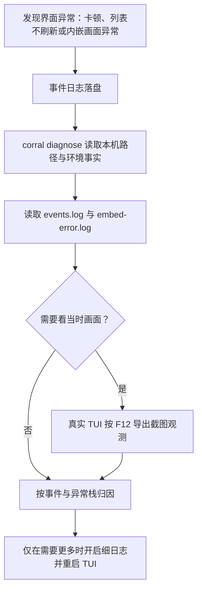

# 可观测与诊断领域知识库

corral 是本地终端应用，诊断信息只留在本机，不发送远程遥测。本文统一使用“事件日志”“诊断”“截图观测（F12）”“界面异常排查”四个主称谓，覆盖 TUI 占用终端时的排障闭环。

## §0 目录索引

| § | 标题 | 何时阅读 |
|---|---|---|
| §1 | 业务背景与核心概念 | 首次处理界面异常排查时 |
| §2 | 诊断闭环 | 卡顿、刷新异常、内嵌画面异常时 |
| §3 | 代码入口索引 | 改事件日志、诊断或截图观测时 |
| §4 | 本地数据与路径 | 查日志、截图和隐私边界时 |
| §5 | 运行组件与事件 | 增加或核对观测点时 |
| §6 | 核心业务规则与隐性约束 | 改代码前必扫的 AI 易错点 |
| §7 | 验证路径 | 完成变更后验证时 |
| §8 | 关联文档 | 进入相邻领域前 |
| §9 | 覆盖度与待补充项 | 判断本文边界时 |

## §1 业务背景与核心概念

终端界面运行后会占用终端，标准错误输出通常不可见；因此，界面异常排查不能依赖临时打印，而要通过本地事件日志、只读诊断和用户主动导出的截图观测建立证据。

| 主称谓 | 含义 | 边界 |
|---|---|---|
| 事件日志 | 一行一条 JSON 的本地结构化事件 | 不记录对话正文，不是远程遥测 |
| 诊断 | `corral diagnose` 输出本机诊断事实 | 只读，不启动 TUI、不写入或接管会话 |
| 截图观测（F12） | 用户在真实 TUI 中导出的当前 SVG 画面 | 可能含真实对话，仅供本地排查 |
| 界面异常排查 | 将事件、异常栈与截图关联定位问题的只读流程 | 不借此修改业务功能或启动会话 |
| 细日志 | 仅在调试开关开启后追加的 debug 级事件 | 默认关闭，不能把详细内容变成常规日志 |
| TUI stall | The event loop does not answer a background probe for 3 seconds | At most one all-thread stack per continuous stall; recovery records elapsed time locally |

## §2 诊断闭环

异常发生后按以下顺序取证；顺序的目标是先获得不打扰现场的客观事实，再补充画面证据。

1. 先执行 `corral diagnose`，确认事件日志、异常日志、截图目录、tmux 版本和配色自检等本机事实；优先看返回里的 `last_error`（最近一次完整 traceback）。
2. 读取事件日志，按时间、事件名、耗时和脱敏后的上下文判断扫描、列表重建、托管或抓帧是否异常。
3. 若出现 `error` 事件或 `last_error` 非空，再读取异常日志取得完整 traceback；事件日志本身只保留异常地点、类型和短消息。
4. 需要确认用户实际看见的布局或画面时，让用户在真实 TUI 内按 F12，再结合同一时间段的日志排查。
5. 默认信息不足时，设置 `CORRAL_DEBUG=1` 或 `CORRAL_LOG=debug` 后重启 TUI，复现一次并读取新增的 debug 事件。

A daemon thread sends one event-loop probe every 0.5 seconds, with at most one probe outstanding. At 3 seconds without an answer it writes one all-thread sample to `stacks.log` and emits `tui_stall`. On recovery it emits `tui_stall_recovered` with the same `stall_id` and `duration_ms`; `stack_attempted=false` means the watchdog could not sample during the stall, such as when it was itself starved. Probing exists only while the TUI runs. Python stack dumps include file/function/line, without local variables or conversation bodies, but the local file is still sensitive. The threshold establishes diagnostic evidence, not a deadlock diagnosis.

Before `events.log` or `embed-error.log` would exceed 256KB, rotate the old segment to `.1` and start a new one. `last_error` reads the current error segment and falls back to `.1` when needed. A failed rotation must not block the TUI. Concurrent processes can still race during rotation, so absence from either segment is not proof an event never happened.

TUI, remote daemon and title generator can write to the same event log. Every event therefore includes `pid`; group by pid before comparing `scan_all`, `list_rebuild` and `tui_stall`. Adjacent timestamps or different session counts do not establish a common process. In the 2026-10-15 off-host Pi report, two uncached full scans took 3.9/4.8 seconds for 508/1213 sessions, while list rebuilds took 1–6ms and captures about 0.2s. Full scans are a candidate source of load; a same-process stall stack is still needed to prove what held the UI thread.

### Hosted assistant startup errors

`host_session` with `ok: true` confirms that Corral hosted the child process; it does not confirm that the assistant completed its own account initialization. The startup-failure panel preserves the child exit code and output, as described in [the embedded terminal knowledge base](EMBEDDED_TERMINAL_KNOWLEDGE_BASE.md). Correlate the failure time before treating `corral diagnose`'s `last_error` as relevant: it can describe an older, unrelated Corral exception.

Codex errors containing `account/read failed during TUI bootstrap` and `workspace routing discovery timed out` require native account/request evidence. The shared authority is [the account-routing timeout investigation](~/.config/agentsync/docs/troubleshooting/2026-10-08-codex-routing-timeout.md), including SubSwap attribution, native SQLite log discovery, read-only account recovery and its verification limits. Corral's [launch ownership rules](CROSS_RUNTIME_HANDOFF_KNOWLEDGE_BASE.md#1-业务目标与不可变边界) explain the separate direct embedded launch and private app-server proxy paths. Do not change Corral launch behavior merely because it surfaced an upstream error.

## §3 代码入口索引

| 场景 | 入口 | 作用 |
|---|---|---|
| 事件日志、脱敏、轮转与写失败降级 | `observe.py` | 统一实现事件、细日志、计时、异常记录、崩溃钩子与截图导出 |
| 一键只读诊断 | `agent_api.py` 的 `cmd_diagnose` | 返回缓存、日志、`last_error`、截图、tmux 与配色自检事实 |
| F12 绑定与用户提示 | `ui/main_screen.py` 的 `MainScreen.action_save_screenshot` | 调用截图观测并在成功后提示保存位置 |
| 抓帧/重扫错误桥接 | `observe.log_embed_error` / `corral._log_embed_error` | 将后台异常同时写成事件与 traceback 文件 |
| 致命闪退落盘 | `observe.install_crash_hooks`、`ui/app.py` 的 `_handle_exception` | 进程/线程未捕获与 TUI 退出前双写 |
| 按需栈转储 | `observe.install_stack_dumps`（TUI 经 `cli.py main`、常驻服务经 `remote/cli.py` 的 `_run_daemon_foreground` 各调一行） | SIGUSR1 时全线程栈追加到 `stacks.log`，触发只用 `kill -USR1` |
| Automatic TUI stall capture | `observe.TuiStallWatchdog` / `ui/app.py` | One pending event-loop probe, bounded stack sample, and recovery timing; stops with the app |
| 后台会话重扫观测 | `store.py` 的 `SessionStore.load` / `refresh` 与 `ui/main_screen.py` 的刷新 worker | 记录 `scan_all`，异常后保留后台循环 |
| 内嵌会话托管观测 | `ui/main_screen.py` 的 `_host_and_focus` / `_host_direct_worker` | 记录 `host_session` 的耗时、运行时和成功状态 |
| 抓帧异常与慢帧观测 | `ui/embed_pane.py`、`embed.py` | 记录 `capture_slow`，异常写入异常日志并继续抓帧 |
| 回归约束 | `test_observe.py` | 覆盖 JSON 行、细日志开关、脱敏、有界轮转、卡顿取栈、计时和异常双写 |

## §4 本地数据与路径

本域没有业务表、没有远程指标库，也不写入各运行时的会话历史。路径均相对当前操作系统用户主目录：

| 本地位置 | 内容 | 读取/写入边界 |
|---|---|---|
| `~/.cache/corral/events.log` / `.1` | 结构化事件日志，一行一个 JSON | 当前和上一段各限约 256KB；旧版超限整文件清空曾使 Pi 现场证据永久丢失 |
| `~/.cache/corral/embed-error.log` / `.1` | 后台异常与致命闪退的完整 traceback | 当前和上一段各限约 256KB；`last_error` 优先当前段 |
| `~/.cache/corral/stacks.log` / `.1` | Manual SIGUSR1 and automatic TUI stall stacks | Bounded current and previous 1MB segments; correlate with event pid and stall id/time |
| `~/.cache/corral/screenshots/tui-*.svg` | F12 导出的真实 TUI 截图 | 仅用户主动触发；可能包含真实对话 |
| `~/.cache/corral/` | 诊断、截图和其它本地缓存根目录 | `corral diagnose` 只报告路径与存在性 |
| `docs/screenshots/list.png` | 文档/验收截图产物 | 仅由虚构演示数据生成，不代表真实现场 |

日志和截图均属于本地敏感材料：不得提交真实会话内容、缓存、日志、token、API 密钥或截图到仓库。

## §5 运行组件与事件

| 组件/事件 | 何时产生 | 默认记录内容 |
|---|---|---|
| `scan_all` | 会话初始加载或后台重扫完成 | `duration_ms`、会话数量、`reason`（`load` / `refresh` / `refresh_live`）、可选 `cache_hit`；未命中共享索引时带 `shared_miss`（`ttl` / `limit` / `keep_ids` / `cohort` / `unreadable` / `disabled`，只记数量与版本，不记会话 id） |
| `scan_index_miss` | 同上 miss 原因变化时（同原因 5 分钟最多一条） | 同 `shared_miss` 的原因与 publisher 事实；定位“`shared_index` 恒 False 到底卡在哪一关” |
| `list_rebuild` | 界面会话列表重建结束 | 耗时与重建模式 |
| `split_group_member_missing` | 浏览既有会话组时，后台扫描暂时未发现某个成员 | 缺失数量；不记录会话名称、标题或正文 |
| `host_session` | 内嵌会话托管成功或失败 | 耗时、运行时、`ok` |
| `capture_slow` | 单次抓帧达到或超过 100ms | 耗时与低基数状态 |
| `host_size_drift` | 抓帧线程发现 tmux 真实尺寸落后于**有效尺寸**（最近被使用的仍存活观看方登记的宽高）并重发 `resize` | 实际/期望宽高与重试次数；同一目标最多 3 次、间隔约 2s。有效尺寸由 `desired_host_size` 按各方 `used_at` 取最近使用者；非赢家窗口自己 crop 或留白。**同一会话在约 2 倍宽度之间来回（如 165↔82）且期间没人操作 = 有路径在后台续票时刷新了 `used_at`、观看方登记丢失，或 `window-size latest` 把窗打回 80 列**，不是单次 resize 失败 |
| `screenshot` | 用户按 F12 成功导出截图 | 本地路径和 SVG 格式 |
| `error` | 抓帧、重扫、截图、TUI/进程未捕获异常等路径 | 位置、异常类型、短消息；完整栈另存 |
| `tui_stall` / `tui_stall_recovered` | UI probe reaches 3 seconds / eventually receives its answer | `pid`, `stall_id`, elapsed or total `duration_ms`, and whether a live stack was attempted/captured |
| debug 事件 | 已开启细日志时 | 仅用于补充诊断上下文，不应承载正文 |
| `corral diagnose` → `last_error` | 只读解析 `embed-error.log` 末条 | `ts`/`where`/`exc_type`/`exc_msg`/`traceback`；无记录为 null |
| 远程 RPC 服务端耗时（Slice0） | 每个成功 RPC 在 `RemoteService.handle` 计业务耗时 | audit 条目 `method` / `duration_ms` / `plane`（control/data）/ `ok` / `req_id`；失败请求不记耗时，由 `remote_method_failed` / `remote_response_send_failed` 覆盖。不记会话 key、正文与参数 |
| `corral remote status` 最近操作 | 运行快照 `recent` + 人读输出 | 每行 `时间 设备 方法 耗时ms [平面]`；旧条目（无耗时字段）只显示前三段 |
| 按需栈转储（SIGUSR1） | 任何运行中的 Corral 进程（TUI、`corral remote _serve`）收到 SIGUSR1 时 | 经 `observe.install_stack_dumps()` 安装的处理器写头行（ISO 时间 + pid）再 `faulthandler.dump_traceback(all_threads=True)`，追加到 `~/.cache/corral/stacks.log`；超 1MB 则轮转保留一代（`stacks.log.1`）。触发只用 shell `kill -USR1 <pid>`，pid 取自只读 `list --live` 可见性；不新增 `agent_api` 子命令（发信号属进程控制副作用，违只读约束） |

`timed` 在操作结束时补充 `duration_ms`，使“发生了什么”和“是否变慢”可在同一事件日志中关联。所有事件含进程 `pid`；其余默认只记录低基数名称和状态。会话文本、提示词、命令参数、令牌等不应作为诊断字段。

## §6 核心业务规则与隐性约束

1. **TUI 下必须落盘。** TUI 占用终端后 stderr 不可靠或不可见，诊断证据必须写入本地文件，不能只靠控制台打印。
2. **写日志失败必须吞掉。** 创建目录、截断或写文件失败都不能拖死抓帧、后台重扫或界面线程；观测是降级能力，不得成为主流程可用性的前置条件。
3. **默认只写低基数事件。** 常规日志仅保留事件名、耗时、状态、运行时等可聚合事实；细粒度上下文只在 `CORRAL_DEBUG=1` 或 `CORRAL_LOG=debug` 时写入。
4. **敏感内容必须脱敏。** 字段名为 `text`、`prompt`、`messages`、`message`、`content`、`body`、`argv`、`command`、`token`、`api_key`、`password`、`secret`（含大小写变化）时，一律以 `<redacted>` 落盘；不要新增近义字段来绕过该规则。
5. **Bounded rotation preserves one previous segment.** The former 256KB whole-file truncation lost Pi `host_session` and identity-migration evidence on 2026-08-26. Current logs rotate to `.1`; inspect both segments promptly because the next rotation replaces `.1`. Interprocess rotation is not transactional, so a missing event still cannot establish that it never happened. Logs must remain bounded and exclude conversation text.
6. **异常需要双层证据。** 事件日志写无 traceback 的 `error`，异常日志写完整 traceback；不要把完整栈或会话内容塞回结构化事件。致命闪退必须经 `sys.excepthook` / 线程 hook / Textual `_handle_exception` 落盘，不能只依赖终端瞬间打印。Textual `WorkerFailed` 等包装异常必须展开到根因（`.error` / `__cause__`）再落盘，事件里可用 `via` 标明外层类型。
7. **诊断必须只读。** `corral diagnose` 只检查本地路径、文件是否存在、tmux 版本和配色自检，并解析 `last_error`；不得启动 TUI、创建会话、写入历史、消费模型额度或改变会话状态。
8. **F12 与验收截图不能混用。** F12 是真实用户现场截图，可能含隐私；`docs/screenshots/capture.py` 用虚构夹具生成仓库验收图。不能用后者替代现场取证，也不能把前者提交到仓库。
9. **SVG 不能证明真彩色。** F12/Textual 的 SVG 导出可能把真彩色压成灰阶；排查 runtime 配色需以真实终端或界面样式验证为准。
10. **界面异常后后台循环应继续。** 抓帧或重扫发生未预料异常时记录错误后继续下一轮，不能因为观测或单次失败让后台线程静默死亡。
11. **活进程卡死时用信号取栈，不加新命令。** `observe.install_stack_dumps()` 在 TUI 与 `remote _serve` 启动时安装 SIGUSR1 处理器（无该信号的平台上为无操作）；诊断时用 `kill -USR1 <pid>` 把全线程栈追加到 `stacks.log`（带时间与 pid 头行，超 1MB 轮转一代）。`agent_api` 保持只读：不得为此新增“向某 pid 发信号”的子命令；取 pid 用既有只读可见性（`list --live` 的 `pid` 字段）。栈文件只作本地排查，不提交仓库。
12. **Test runs still write into the real `events.log`.** `observe.EVENTS_LOG` is resolved once at import, so a test that later points `CORRAL_CACHE_DIR` at a temp dir still logs to `~/.cache/corral/events.log`; only UI workers in `scripts/ci-test.py` enter `isolated_test_resources` before import. Observed 2026-10-05: bursts of hundreds of `remote_device_attached` / `remote_device_superseded` events in one second, with empty `device` and `address`, landed in the user's log during a connection investigation. Until fixed, filter those bursts out (empty device and address, same second) before attributing them to real clients. Improvement item: resolve the log path per call from the environment, or isolate every CI worker, like the parallel fix for the derived cache's import-time path.

## §7 验证路径

| 验证目标 | 操作 | 通过标准 |
|---|---|---|
| 事件日志基础契约 | `python3 -m unittest -v test_observe.py` | JSON 行包含时间、级别和事件名 |
| 细日志开关 | 在测试或本机分别关闭/开启 `CORRAL_DEBUG=1`、`CORRAL_LOG=debug` | 默认不写 debug，开启后才出现 debug 事件 |
| 脱敏与容量边界 | `python3 -m unittest -v test_observe.py` | 敏感字段变为 `<redacted>`；超限后当前段继续写，上一段在 `.1` 可追查 |
| Automatic stall sample | `test_observe.py` and a real TUI/Pilot run | One outstanding probe, one stack per continuous stall, matching recovery id/duration, watchdog stops with TUI |
| 异常双写 | `python3 -m unittest -v test_observe.py` | `error` 事件无 traceback，异常日志有完整 traceback |
| 只读诊断 | `python3 -m corral diagnose` 或已安装命令 `corral diagnose` | 返回当前/上一段日志路径、栈路径、`last_error`、tmux 与配色事实；不启动 TUI |
| 事件现场读取 | `python3 -m corral diagnose` 后读取 `data.last_error` 或 `~/.cache/corral/events.log` | 能看到最近闪退栈，或按 JSON 行查看 `scan_all`、`list_rebuild`、`host_session`、`capture_slow`、`host_size_drift`、`error` 等 |
| TUI 卡死 / 按键极慢取证 | 先 `corral diagnose`，按 `pid` 读两段事件日志的 `tui_stall` / `tui_stall_recovered`、`scan_all` / `list_rebuild` / `capture_slow`，再看 `stacks.log`；对照 `corral --version` | A stack sampled during the same stall identifies the blocked Python path; timings alone show correlation, not causation. `refresh` spikes with `cache_hit=false` point to full scans; check old-process state and `PERFORMANCE_KNOWLEDGE_BASE.md`. faulthandler 栈没有线程名，按栈内容区分等锁者与持锁者再定责：停在 `with self.lock` 的 C 级 acquire（Textual/asyncio 帧在下）的是被堵住的 UI 线程，停在 `subprocess._wait` 且上层是 `_merge_scanned` 的是持锁的刷新线程——2026-10-15 现场曾把后者误读成“主线程卡在 reconcile”。 |
| 远程 RPC 服务端耗时取证 | `corral remote status` 看最近操作行的 `耗时ms [平面]`，或读运行快照 `recent` 的 `duration_ms` / `plane` / `req_id` | 成功 RPC 必带耗时与平面；`session.*` 走 data 说明数据面生效，走 control 说明未附着或回落。失败请求无耗时条目，查 `events.log` 的 `remote_method_failed` |
| 截图观测 | 在真实 TUI 中按 F12 | 生成 `~/.cache/corral/screenshots/tui-*.svg`，并只作本地排查使用 |
| 按需栈转储 | 对活进程 `kill -USR1 <pid>` 后读 `~/.cache/corral/stacks.log`（`test_observe_stacks.py` 覆盖头行/追加/轮转） | 头行含 ISO 时间与 pid，其后为全线程栈；超 1MB 时上一段仍在 `stacks.log.1` 可查 |
| 验收截图消歧 | `python3 docs/screenshots/capture.py` | 生成虚构数据的验收图；不读取真实历史，不替代 F12 现场截图 |

## §8 关联文档

| 文档 | 联读场景 |
|---|---|
| `docs/TERMINAL_UI_KNOWLEDGE_BASE.md` | 排查终端界面刷新、快捷键、列表或右栏展示异常时 |
| `docs/PERFORMANCE_KNOWLEDGE_BASE.md` | `scan_all` 过密、`refresh_live` 未出现、TUI 卡死归因到全量重扫或抓帧时；可观测只取证，性能根因与已落地修法以该文为准 |
| `docs/EMBEDDED_TERMINAL_KNOWLEDGE_BASE.md` | 排查内嵌实时终端、抓帧、控制通道或托管画面问题时；抓帧协议细节以该文档为准 |
| `docs/SKILL.md` | 面向 Agent 执行“界面异常排查”只读流程、解释 `corral diagnose` 时 |
| `PRIVACY.md` | 判断日志、截图、会话历史和本地缓存的隐私边界与提交限制时 |
| `docs/MAINTAINER_GUIDE.md` | 修改或评审可观测性实现、事件名、性能观测和 F12 行为时 |

## §9 覆盖度与待补充项

本文根据事件日志实现、诊断子命令、F12 入口、观测测试、维护指南、Agent 使用文档和隐私说明编写，覆盖本地诊断闭环与隐私边界。

刻意不覆盖：

- 业务功能本身的修复策略；
- 内嵌实时终端的抓帧协议和控制通道实现细节，参见内嵌实时终端知识库；
- 发布、远程遥测、Prometheus 或任何远端收集方案；
- 未在当前实现中定义的日志保留天数、上传、检索或告警机制。

State-refresh tests that claim a live process must use a real owned process PID (or explicitly mock the first-hand PID probe). Invented PIDs become ended under the current disk/process freshness check and invalidate attention, external-session, and stop-tombstone fixtures. This requirement preserves production liveness checks.

<!-- 该文档整理/压缩于 2026-09-05 -->

## Relay connection timelines

Host relay events use `lane` (`interaction`/`bulk`) and a monotonic attempt number scoped to the event's PID. `remote_relay_attempt` starts opening; `remote_relay_connected`/`remote_relay_bulk_attached` indicate WebSocket opening only. `remote_relay_ready` confirms the protocol acknowledgement and includes relay generation/node for comparison with the relay journal. Online status requires this acknowledgement. Open and acknowledgement deadlines are each 10 seconds; failed close handshakes wait at most 2 seconds. Existing 20-second ping interval and 60-second heartbeat tolerance are unchanged.

`remote_relay_receive_failed` records the observed failure before cleanup; the subsequent disconnected event includes close-wait duration. Opening versus registering versus active stages, exception class, numeric sent/received close codes, last application-frame age and positive measured ping RTT narrow the failed phase. `remote_relay_retry_scheduled` records the actual jittered wait. These timings are local evidence, not an end-to-end phone latency measurement. Sleep-inclusive/uptime clock divergence produces `failure_kind=system_resume` and a suspension duration; it rebuilds stale sockets without changing system power policy. Missing OS clock support keeps ordinary heartbeat recovery. No conversation bodies, auth headers or keys are logged.

Read these events alongside the existing Apple [client diagnostic entry](../../apple/docs/design/IOS_OPTIMIZATION_PROGRAM.md#agent-diagnostic-entry). Phone records cannot be copied when the device is unavailable. Absence of a phone attempt start prevents claiming its complete wait or blaming its network. Incident evidence, recovery rules and physical acceptance limits are maintained in [Relay recovery](REMOTE_KNOWLEDGE_BASE.md#relay-recovery-and-connection-evidence-2026-10-17).
