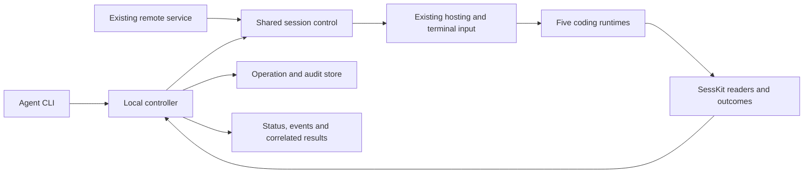

# Agent session delegation: research and proposed contract

Status: research completed on 2026-10-20; implementation and release pending.
Expanded research includes fresh-session creation, explicit model selection and
the [bundled skill distribution contract](BUNDLED_AGENT_SKILLS_DESIGN.md).
The owner requested research first, followed by development using `agent-friendly-cli`.
The outcome below is adopted; command names and engineering choices are proposals.
No command under `corral run` described here exists in 0.24.335.

## 1. Requested outcome and ownership

An agent reviewing code must be able to find the historical session responsible for
a feature, inspect enough evidence to select it, send a repair brief to that exact
session, resume it when stopped, and observe the resulting work and final response.
The calling agent must survive disconnection/restart without losing the operation
or accidentally issuing the repair twice. A question from the target must be
observable and answerable through the same workflow.

The owner's additional requirement on 2026-10-20 makes historical discovery
optional: a caller can also create a fresh session, explicitly select one of the
five supported runtimes and optionally a model, supply its initial requirement,
and observe execution and results through the same run contract. Fresh creation
does not require or fabricate a source session. Both entry paths are first-class
Corral middleware capabilities; neither depends on runtime-native agent teams,
subagents, messaging, background-session managers or orchestration APIs.

Owner clarification (2026-10-20): this capability belongs to the Corral middle
layer and must be decoupled from the coding agents. Corral owns the unified
control/monitoring contract, hosting, input delivery, queue, operation state and
result correlation. Do not depend on Claude cross-session messaging, per-vendor
SDKs, ACP or vendor-specific control APIs for this workflow. Ordinary executable
launch/resume arguments remain in the existing runtime adapters; observation
consumes SessKit's normalized history. Runtime-specific readiness/composer/key
differences remain bounded adapter details, not separate orchestration systems.

This requirement supersedes the former product-wide ban on agent-driven session
control. Existing query commands remain queries; generating a continuation plan
does not authorize its automatic execution. Do not silently add execution to
`search`, `show`, `context`, or `plan continue`.

Corral owns target selection, native resume, hosting, instruction delivery,
operation identity, permissions, audit, supervision and result presentation.
SessKit owns native history interpretation, incremental readers, typed events,
turns and outcome evidence. The current dependency already supplies the reusable
reading primitives; this feature does not by itself justify a SessKit change.
Any demonstrated missing native evidence must be fixed upstream, released and pinned.

Native resume preserves the runtime's stored conversation, subject to its own
compaction and configuration. It does not restore process memory or guarantee the
same model/account, unchanged files, or a correct repair. Return the actual runtime,
model when observable, project and source evidence; the caller still reviews the work.

Explicit model selection is caller-owned. An omitted model inherits the runtime's
configuration. A supplied model is scoped to that requested fresh launch, never
written into global runtime defaults or silently replaced with Corral's choice.
Record requested and observed model separately; a successful process launch does
not establish the model actually used. This extends the former direct-launch-only
exception to the owner's default-model rule.

Shared interpretation constraints remain in the
[session integration guide](~/.config/agentsync/docs/AGENT_SESSION_INTEGRATION_GUIDE.md).
The [existing butler design](WEB_TASK_BUTLER_DESIGN.md) is an adjacent consumer,
not authorization to build its editor, coordinator, task board or scheduling policy here.

## 2. Verified baseline

Source: CLI `001aec1108a049069a1f2095d13927b4a179b03d`, version 0.24.335.
The active absolute CLI entry also reported 0.24.335 from its pipx installation.
The checkout doctor reported ready, no blockers and no warnings. Its explicit
`behavior_verified:false` was preserved; readiness is not product acceptance.

| Installed tool | Version observed | Probe scope |
|---|---|---|
| Claude Code | 2.1.304 | Version and help; no model request |
| Codex | 0.163.0 | Version and app-server help |
| OpenCode | 2.0.32 | Version, run and V2 serve help |
| Cursor Agent | 2026.10.18-ea085cb | Version, print/resume, persist and ACP help |
| Pi | 1.3.0, `@earendil-works/pi-coding-agent` | Version, help and installed RPC documentation |
| tmux | 3.8 | Version only |
| SessKit | 0.2.14 | Actual checkout-environment package, not the library checkout |

### Existing CLI and underlying mechanisms

| Requirement | Current implementation and evidence | Gap for this workflow |
|---|---|---|
| Keyword discovery | `agent_api.cmd_search`; metadata search, then conversation text with `--deep`; AND keywords, relevance ranking and coverage counts | Bounded scan, default 50 per runtime; not all historical content; no CLI search project/date filters or continuation cursor |
| Inspect candidate | `show`, `share`, `context`; unique `runtime:id`, prefix ambiguity errors, transcript export | No control-version token or actionable control capabilities; title similarity does not prove authorship |
| Resume with new instruction | `plan continue` returns safe argv/cwd; Claude, Codex, OpenCode and Cursor generated plans in actual read-only probes | External execution only; no operation/supervision; Pi returned `not_resumable` because it inherits the unsupported base method |
| Reuse a running target | `live`, `keepalive`, `pid`, `attention` are visible | No agent CLI dispatch command; a live hosted Codex still received a successful external continuation plan |
| Resume and inject | `remote.sessions.SessionHub.send_text`, `resume_session`, dead-pane recovery, startup/composer checks | Internal to the remote service; not an agent command or durable task execution contract |
| Create a fresh target | `SessionHub.new_session` → runtime `build_new_session_plan` → `_host`; registers a provisional hosted identity before native history exists | No agent CLI create-and-submit transaction, per-run model option, or durable creation receipt |
| Reconcile input | `CommandReceiptStore`, `RemoteService._run_receipted_input`; persistent command IDs, digest mismatch rejection, ambiguous dispatch on restart | A delivery receipt ends at input delivery, not at model consumption, execution or completion |
| Observe changes | Remote subscriptions plus SessKit typed activity and incremental readers | Agent CLI has only snapshots; no operation-bound cursor, bounded wait, durable event stream or result retrieval |
| Establish repair success | Transcript and tool records can supply evidence | A completed turn or a worker saying “fixed” does not prove a P0 repair passed its acceptance criteria |

Relevant source anchors: `src/corral/agent_api.py` (`cmd_search`, `session_payload`,
`cmd_plan_continue`); `src/corral/runtime/{base,claude,codex,opencode,cursor,pi}.py`;
`src/corral/remote/{sessions,service,command_receipts}.py`; `src/corral/codex_proxy.py`.

### Search limitations that matter

1. `--deep` searches `ConversationMessage.text`, not tool arguments/results or
   thinking. A file/function mentioned only in a patch or shell command can be missed.
   `share` exposes those records, but is not itself a search engine.
2. `--limit` is scan depth per runtime; `--top` is returned result count. A no-hit
   probe with `--limit 1` reported `scanned:6`, `returned:0`,
   `potentially_limited:true`; it did not establish the absence of relevant history.
3. Discovery depth and later reference resolution differ: search can find an old
   session under a large limit while `show`/`plan continue` default to 200. Writes
   need an exact verified native locator, not another shallow recency scan.
4. Project directories that no longer exist are filtered by the existing resume
   listing contract. Missing project/history must be explicit, never default to the
   caller's cwd or start a blank replacement conversation.
5. The TUI/remote `ConversationIndex` already persists normalized conversation
   entries and returns matching lines. Reuse its reading/cache mechanisms where
   compatible, but preserve the CLI's published relevance ordering and coverage.
   It is not a SQLite FTS engine and currently indexes conversation text only.
6. The all-runtime CLI probe included dormant Kimi in coverage metadata. New control
   discovery must enforce the five-runtime product allowlist; do not expose dormant
   execution. This is a recorded discovery gap, not a fix made by this research.

### Delivery semantics must stay honest

The current remote contract deliberately defines delivery as successful preflight,
terminal injection and a surviving pane. Native history may be delayed for busy
agents. This owner decision is recorded in `verify_text_injected` and the
[remote knowledge base](../REMOTE_KNOWLEDGE_BASE.md); do not silently strengthen
or change the existing mobile receipt's meaning.

The September butler experiments' “history-confirmed delivery” is historical
research, not today's input receipt definition. A new operation should expose
`accepted`, `input_submitted`, `native_recorded` and correlated execution evidence
separately. Here `native_recorded` means SessKit observed the persisted input,
not that Corral called a vendor API. Missing evidence stays unknown. Composer disappearance improves the
terminal path but does not prove that the intended model turn completed.

## 3. Runtime research and reusable references

The chosen transport is Corral's existing hosted terminal input path, shared by
all five runtimes. Queueing and supervision live in Corral. History observation
and finality interpretation live in SessKit. No per-vendor live-control backend,
message bus, SDK, API broker or new agent plugin is proposed for this capability.

| Runtime | Corral integration direction | Adapter/evidence boundary |
|---|---|---|
| Claude | Existing hosted terminal, paste/submit and resume plan | Preserve existing composer/startup handling and full conversation identity. Do not route through Claude peer messaging or background-agent management. |
| Codex | Existing hosted terminal and exact session claim; ordinary resume plan | Reuse the current hosting wrapper as-is. Do not extend its private app-server proxy into an Agent-control API broker. |
| OpenCode | Existing hosted terminal, paste/submit and resume plan | Preserve session identity and composer verification; do not call the vendor HTTP API for input/queueing/observation. |
| Cursor | Existing hosted terminal, paste/submit and resume plan | Its input behavior differs while busy. Keep only proven key/readiness differences in the adapter; do not introduce ACP or SDK execution. |
| Pi | Existing hosted terminal, paste/submit and resume plan | The missing `plan continue` override is not a blocker for a controller that already resumes through `build_resume_plan`. No RPC-mode dependency or additional control extension. |

Vendor mechanisms were researched to understand limitations, then excluded from
the architecture by the owner's clarification. Findings remain useful background:
Claude's peer messaging/inbound controls are vendor-owned; Codex has native turn
IDs; OpenCode's installed V2 API differs from its older server docs; Cursor ACP
loading is not an arbitrary TUI attach; Pi distinguishes low-level `agent_end`
from settled execution. These facts do not make those interfaces product
dependencies. Equivalent native-history interpretation belongs in SessKit when
the recorded evidence exists; otherwise Corral must report limited/unknown evidence.

Primary sources checked:

- [Claude programmatic execution](https://code.claude.com/docs/en/headless),
  [cross-session messaging](https://code.claude.com/docs/en/cross-session-messaging),
  [agent view](https://code.claude.com/docs/en/agent-view).
- [Codex App Server](https://learn.chatgpt.com/docs/app-server).
- OpenCode V2 tag `v2.0.32`, commit `843a6c514e606b436a7fe713422ace0a93ad3d61`:
  [OpenAPI](https://github.com/anomalyco/opencode/blob/v2.0.32/packages/protocol/openapi.json),
  [actual prompt handler](https://github.com/anomalyco/opencode/blob/v2.0.32/packages/server/src/handlers/session.ts#L308).
- [Cursor ACP](https://cursor.com/docs/cli/acp) and
  [headless CLI](https://cursor.com/docs/cli/headless).
- [Pi RPC](https://github.com/earendil-works/pi/blob/73f8de80bc87021375f8b525292ac07492253002/packages/coding-agent/docs/rpc.md)
  and `packages/coding-agent/src/modes/rpc/rpc-mode.ts` at the same inspected commit.

### Reference implementations actually inspected

| Reference / source snapshot | Reuse conceptually | Do not copy |
|---|---|---|
| [coder/agentapi](https://github.com/coder/agentapi/tree/7c468d5b25ec9d3d76c41313cf4e08904ff5968d), `lib/screentracker/pty_conversation.go`: `Send`, `sendMessage`, `isScreenStableLocked` | Historical reference for one controlled input queue, explicit readiness, status/events surface | Archived/deprecated upstream, not a new dependency; screen stability as business completion; a second terminal parser beside SessKit |
| [claude-session-driver](https://github.com/obra/claude-session-driver/tree/319bb0fe2960ba8f3a7eff2f786f9c57e284eecc), `src/commands/{converse,wait-for-turn}.ts` | Capture a pre-send event boundary, then await and collect a new reply | Waiting for any later stop/session_end without exact operation correlation; returning partial text with success after its finality check expires |
| Existing Corral remote receipts and recovery | Digest identity, durable intent before injection, rejection vs uncertainty, target input serialization, startup/composer safeguards | Constructing a fake paired device, enabling relay for local CLI control, using per-process receipt locks as cross-process ownership |
| SessKit 0.2.14, actual installed library | Typed events, turns/outcomes, provenance, incremental readers and generation reset | Re-parsing native JSONL/SQLite in the CLI; equating inferred completion with a native guarantee |

## 4. Proposed agent-facing contract

Keep existing discovery commands and add one `run` command family. A run means
one requested delegation with its messages and runtime attempts, not a permanent
business task. The caller owns prioritization, semantic task splitting and repair
acceptance. Store a caller task reference when supplied, without implementing a
second task-management product.

```text
corral search <keywords...> --deep --cwd <project> --top 5
corral show <runtime:id> --messages 12
corral run submit <runtime:id> --prompt-file <brief> --if-version <token> --idempotency-key <key> --dry-run
corral run submit <runtime:id> --prompt-file <brief> --if-version <token> --idempotency-key <key>
corral run create --runtime <runtime> --cwd <project> --model <model-id> --prompt-file <brief> --idempotency-key <key> --dry-run
corral run create --runtime <runtime> --cwd <project> --model <model-id> --prompt-file <brief> --idempotency-key <key>
corral run status <run-id> [<run-id> ...]
corral run events <run-id> --after <cursor> --limit 50
corral run wait <run-id> --timeout 30
corral run result <run-id>
```

These examples are a proposal, including `search --cwd`; they must not be copied
as instructions for the current release. Additional write verbs are
`run message` (steer or answer an identified pending question) and
`run interrupt` (cancel only the correlated active turn). Both require a fresh
run version and a message/operation idempotency key. Do not expose generic shell
execution, arbitrary PID kill, native slash-command injection or history deletion.

### Fresh creation and model selection

`run create` and `run submit` have different target preconditions but return the
same run handle, state axes, events and result shape. Creation requires an explicit
runtime and project; `--model` is optional. No old-session fingerprint is required
for a create, but an idempotency key binds the immutable creation specification,
including runtime, cwd, explicit model and initial brief. Retrying the same
request must return the same creation attempt, not another agent process.

Persist intent and allocate Corral's hosted identity before launching. Keep
`run_id`, hosted identity and native session identity separate. Native identity
may arrive only after the first prompt; bind it using the existing managed
identity/claim machinery, never by newest file, title, cwd or timestamps alone.
Return the durable run during `starting`, even before a native session reference
is available. A crash after launch but before registration must reconcile the
original hosted identity; uncertain ownership cannot authorize a second launch.
Verify startup and requested model before initial input where the runtime exposes
that evidence. Record unresolved identity/model checks explicitly; do not claim
model compliance from argv alone. An explicit model mismatch must not become a
successful execution under a different model.

Keep model selection in the runtime adapter: ordinary launch flags or a verified,
session-scoped terminal interaction. No vendor control API, permanent config edit,
copied credential, automatic account switch or hard-coded model ranking. A model
catalog is discovery evidence, not proof of entitlement or actual selection.
Expose requested identifier, resolved identifier when known, evidence source,
observation time and selection capability. Reject ambiguous fuzzy selections.
Unresolved/unsupported selection must return an actionable limitation, never
ignore `--model` or fall back to another model. Preserve runtime defaults when the
flag is absent; don't restart an already running historical target to change it.

The 2026-10-20 help probes confirmed launch `--model` for installed Claude, Codex,
Cursor and Pi (Pi also supports provider-qualified identifiers). **OpenCode
2.0.32 is a concrete compatibility gap:** its installed root help and inspected
root command schema have no `--model`, while its public CLI page still documents
one. A separate `opencode mini --help` probe does expose `--model`; it is a
candidate ordinary interactive CLI entry, not proof of equivalence to Corral's
existing hosted mode (readiness, identity, permissions and resume need acceptance).
The full TUI also has model-selection state, but that does not establish a
supported root flag or a non-persistent selection path. Verify a suitable ordinary
launch/terminal path before advertising this capability; don't use its HTTP API
to conceal the gap. Sources: [Claude CLI](https://code.claude.com/docs/en/cli-reference),
[Codex CLI](https://learn.chatgpt.com/docs/developer-commands),
[Cursor CLI](https://cursor.com/docs/cli/reference/parameters),
[OpenCode CLI](https://opencode.ai/docs/cli/) and inspected OpenCode tag `v2.0.32`
`packages/cli/src/commands/{commands.ts,handlers/default.ts}`.

### Target and search contract

- Add exact project/date/runtime filtering, explicit `--scope conversation|activity`,
  paged coverage and matching evidence. Activity scope includes normalized tool
  records; large tool results are searched incrementally, not dumped into stdout.
  Decide index size/latency from measured histories before selecting a new engine.
- Return full `session_ref`, exact source locator, cwd, match excerpts/roles,
  control capability/evidence and a version token. Keep title/recency as retrieval
  evidence, never as proof that the session authored a feature.
- Report current repository identity, HEAD and a bounded dirty-workspace summary
  when available, so the brief can distinguish historical assumptions from today's
  code. Never clean, check out, stash or reset the workspace to recreate old context.
- One search hit never triggers a write. The caller resolves semantic ambiguity;
  the CLI blocks ambiguous identities and unsafe ownership automatically.
- Keep the five active runtimes. Do not expand support as part of this feature.

### Submit and lifecycle contract

1. A stopped session is resumed through the existing adapter under the same
   runtime/session identity and valid original project. A live hosted session
   reuses its Corral-owned terminal. A live external session without that terminal
   returns `external_session` with a useful next command and can be resumed once
   its original owner ends; do not switch to vendor messaging or spawn a duplicate.
   A timeout means unknown liveness, never stopped.
2. Proposed default for a busy target: queue after the active work; explicit
   `--on-busy steer` changes the active direction, and `reject` makes the caller
   decide. Phone sends keep their existing steering semantics. Never pretend
   queue and steer are equivalent when an adapter lacks one capability.
   Corral holds queued briefs itself and dispatches only on positive readiness
   evidence. Mid-turn delivery uses the existing terminal path; report the actual
   observed disposition and never promise that it interrupts a running tool or
   that a vendor consumes it immediately. Uncertain readiness keeps the brief
   queued or returns a bounded status, rather than relying on a quiet screen.
3. Existing unanswered permission/question dialogs are not idle task inputs.
   Surface `waiting_input` with the exact interaction identity; a new repair brief
   cannot accidentally approve a permission or answer an unrelated question.
4. Return promptly with a durable `run_id`; execution and observation continue
   after the invoking CLI exits. Explicit bounded waits never cancel the worker
   on timeout or Ctrl+C. A separate authenticated interrupt targets only that run.
5. Same actor + idempotency key + immutable target/input/mode returns the original
   run. Same key with a different payload returns conflict. After uncertain paid
   dispatch, reconcile native evidence; never automatically resubmit.
6. Record caller, target, source generation, baseline event position, native
   message/turn identifiers when available, runtime attempt identity and delivered
   evidence. A later unrelated message must not satisfy this run's completion.
   Proposed terminal-path correlation: prefix the submitted brief with a compact,
   visible Corral run/message identity and keep the original brief verbatim inside
   that envelope. Match only a new normalized user event after the captured
   baseline in the expected generation. Quoted markers in assistant/tool output
   are not delivery evidence. If the runtime has not persisted that input yet,
   expose submitted-but-unobserved rather than inventing a turn association.
7. When human/other-agent input overlaps and native evidence cannot separate its
   result, expose mixed attribution/unknown, not an exclusive result. Initial
   implementation should serialize independent delegated runs per session while
   allowing explicit steering messages within the current run. Do not lock an
   entire repository merely because independent tasks share its working tree.
8. Detect self-targeting and caller-chain cycles when caller identity is known;
   apply bounded queue/capacity limits. Do not claim complete cycle detection for
   unmanaged callers without ancestry evidence.

### State, events and results

Keep three independent observations rather than a single misleading status:

| Axis | Proposed fields / states |
|---|---|
| Delivery | `accepted`, `dispatching`, `input_submitted`, `native_recorded`, `rejected`, `unknown`; evidence origin and observed-at time |
| Execution | `queued`, `starting`, `running`, `waiting_input`, `completed`, `failed`, `interrupted`, `unknown` |
| Acceptance | `unverified` by default; caller-owned acceptance evidence, not inferred from assistant prose |

`completed` means the correlated runtime work ended normally. It never means the
bug is fixed. Return the response and normalized tools/errors for the relevant
range, native IDs, evidence confidence, observed model, recorded usage if present,
started/finished timestamps and elapsed time. Missing usage/cost stays null; no
estimate is presented as actual billing. A result command can successfully return
a known failed run; `ok` describes the query, `execution.state` describes the work.

A terminal run remains terminal. A repair follow-up starts a new run on the same
session and can reference its predecessor; it does not reopen the old run or
replace its result. Answers/steering within an active run remain messages of that
run. Preserve separate identities for caller, session, run, delivery message and
launch attempt. A single session status cannot substitute for all of them.

Events include state changes, message/tool summaries, output, questions, errors,
correlation and final response, with `seq` plus a generation-aware opaque cursor.
Read only new events by default. Optional follow mode uses explicitly advertised
JSONL records, bounded buffering and an idle deadline. A missing retained cursor
returns a resync requirement with a snapshot path, never silent event loss.
Subscription/cursor setup precedes dispatch so very fast completion cannot be missed.

`wait` returns on completion, failure, interruption or required input. A wait
deadline is an exit-6 `wait_timeout`, with the same run ID and status next command;
it is not an execution failure. Event reads/status must remain available after
controller restart even when the underlying runtime is temporarily unreachable.

For several runs, provide one bounded wait over a selected set, returning on the
first actionable change (`waiting_input`, failure or terminal outcome). Avoid one
poll loop per worker. Events should be persisted before publication; if durable
storage fails, report degraded/unavailable observation rather than acknowledge a
durable cursor that exists only in memory. Report observer heartbeat, last runtime
output and last normalized progress separately. A healthy observer and a quiet
terminal prove neither model progress nor a hung worker. A caller may detach and
later resume from the cursor without stopping the target. Automatic wake-up of a
caller, if added, must use Corral's own controlled delivery with deduplication and
cycle bounds, not a runtime-native notification tool; it is not a prerequisite for
bounded wait/events/result.

## 5. Proposed architecture and durability



Extract a bounded shared session-control core from the remote hub; do not create
a second implementation of resume, paste or recovery. Keep `agent_api.py` and
bootstrap's fast paths lightweight. A local controller is independent of remote
pairing, relay enablement, network access and optional cryptography packages.
Reuse a compatible existing controller if discovered; otherwise start one local
owner on demand through a private Unix socket on supported macOS/Linux systems.
Version-mismatched clients fail with upgrade guidance rather than modifying state
through an incompatible running controller.

Store durable run/messages/events and append-only audit records under
`XDG_CONFIG_HOME/corral/control/` (default `~/.config/corral/control/`). Use SQLite
transactions for intent, state transitions and actor/action/target/timestamp audit
rows together. Private runtime sockets and state are restricted to the current OS
user; configure actors/tenants explicitly for any future service exposure. Same
Unix UID is not an isolation boundary between mutually hostile local processes.
No public listening port or relay is needed for the local agent workflow.

Attribute delegated input to the calling actor/run rather than presenting it as
new owner consent. Enforce the caller's authorized targets/actions at the control
boundary; do not use a more privileged historical worker to bypass a denied
action or answer its permission prompt. Existing runtime launch policy remains
explicit and observable, never silently relaxed to make a test pass.

There is no atomic transaction spanning SQLite and an arbitrary terminal input.
Promise durable intent, one controller-owned dispatch and conservative recovery,
not universal exactly-once execution. Corral's own operation/message IDs and
input ownership provide the dispatch boundary; there is no dependency on a
vendor's idempotency API. Accepted-but-not-dispatched work can resume safely; possibly injected
work reconciles or stays unknown. Keep deduplication tombstones after compacting
large logs so an old retry cannot become a fresh dispatch.

Cross-process ownership must cover resume plus actual input transactions, not just
one controller's Python lock. Honor the existing terminal input ownership so
navigation, phone/Mac typing and agent input cannot interleave into one composer.
Per-target operation leases must also prevent automatic idle reclamation from
stopping a run with active work. They do not reserve unrelated projects or block
routine releases.

## 6. Agent-friendly CLI review

Review of every `agent-friendly-cli` design-principle item, scoped to this workflow:

| Item | Existing baseline / required design work |
|---|---|
| P0 noninteractive | Query commands already return JSON; preserve non-TTY fallback. New writes must never wait on a hidden prompt. |
| P0 envelope | Existing `{ok,data,error,meta}` is reusable, including failures. Advertise JSONL explicitly for streams. |
| P0 exits | Existing 0/1/2/3/5 are useful; add 4 for authorization, 6 for wait deadline; stable error codes distinguish busy/unsupported/unknown. |
| P0 dry-run | Read-only plan exists, but no write path. New dry-run cannot launch a controller/runtime, create state/cache/locks or consume model quota. Same data shape as submit, with planned state. |
| P0 verify/status | Diagnose exists; add operation status/result and read-only control diagnostics. Command exit 0 is not repair success. |
| P0 input validation | Safe argv plans exist. New path: validate exact session references, prompt file/stdin size, JSON types and control characters; never shell-interpolate. |
| P0 availability | Companion skill already pins an absolute CLI and trusted installation. Add capability probes for control so stale versions do not trigger direct runtime workarounds. |
| P1 describe | Existing COMMANDS/parser shared definition is a good base; extend risks, input schemas, output states, preconditions and examples from the same source. |
| P1 errors | Existing code/hint/absolute next_commands are reusable; cover conflicts, missing capability, disconnected runtime and ambiguous dispatch. |
| P1 size/coverage | Existing scanned/matched/returned/truncated/failures are useful; add history-read coverage, time scope, paging and event byte limits. Preserve full locators. |
| P1 operation/WAL | Remote input receipts exist; add durable runs and transactional audit rather than treating delivery receipts as a task ledger. |
| P1 read-before-write | No existing control version. Add stable target/control fingerprints, fresh run versions on message/interrupt, post-write objects/new tokens. Exclude volatile activity timestamps. |
| P1 companion skill | Existing SKILL is query-only. Ship the approved corral-search/corral-delegate bundle with discovery/selection, create or resume, dry-run, submit, observe, answer, result and unknown-state recovery. Share one command authority with the existing guide; never expose proposal commands before shipping. |
| P1 batching | Reads can return many sessions; add batch status/wait with per-run failures and bounded concurrency. Writes always select one target. Piped prompt input is explicit, never guessed JSON. |
| P1 matching | Prefix ambiguity errors exist; control writes require the canonical full identity and version. Do not auto-pick the highest relevance hit. |
| P2 transport consistency | No new MCP is required. If added later, share the same controller and response semantics; do not build a separate executor. |
| Human default | Existing query JSON is published behavior and stays compatible. New commands may show short human output on a TTY; `--json`/non-TTY uses the stable envelope. |
| Interaction parity | Every write has complete noninteractive flags; questions are structured run state, not a terminal prompt. |
| Dual fields/time | Stable English states plus human labels; epoch and explicit UTC timestamps; no emoji parsing or zone-less new timestamps. |
| Two-layer errors/help | Stable English error code, readable message, effective flags only, short examples and correct side-effect/risk metadata. |
| Short success path | Reuse existing search/show; one submit yields a run handle. Compact status/events avoid rereading the full historical conversation. |
| Evolution | Additive old query fields/commands; do not change old `status`, receipt `delivered`, `--limit`, `--top`, or `plan continue` meanings. Version new control contracts separately. |
| Resilience | Local operations do not require relay/model catalog lookups; status survives runtime outage; bounded wait and nonblocking submit; explicit opt-out for automatic controller startup. |

## 7. Evidence and acceptance still required

Research observations performed on 2026-10-20:

- Active CLI version and `describe` were run through its absolute entry.
- An actual no-hit deep-search probe verified limited-coverage reporting.
- For each active runtime, the newest candidate was listed and a continuation plan
  requested without executing it: four succeeded, Pi returned `not_resumable`;
  the live hosted Codex plan remained `external_only`.
- SessKit 0.2.14 read one real history per active runtime through typed snapshots
  and its corresponding incremental reader. All five were readable; every
  unchanged second poll returned zero events. Sampled outcomes included native,
  inferred and unknown evidence, reinforcing the need to expose confidence.
  This sample does not establish complete historical or completion coverage.
- Existing focused tests: `scripts/ci-test.py --run-modules
  test_agent_api,test_command_receipts,test_remote_resume,test_remote_creation_delivery`:
  **93 tests passed, 0 skipped, no diagnostic warnings**, final recorded run 9.824 s.
  This included a synthetic real-tmux resume fixture, not a model-driven repair.
  Complete output was captured and inspected. A first attempt to invoke pytest
  did not run because pytest is not a project dependency; the maintained unittest
  runner was used instead. No test dependency was added.
- No real repair instruction was sent to an existing user session. No new model
  request, account change, remote-service restart, UI change or product release
  was performed. Independent agent usability was not evaluated in this phase.

Development acceptance must include all of the following, not just this baseline:

1. A disposable feature-development session holds a fact absent from the calling
   agent's brief. Search finds it; native resume preserves its identity/context;
   the worker performs a repair and the caller retrieves only the new result.
   Also exercise creation without any history: select runtime/model and project,
   send the initial brief, observe the first turn, answer a question, retrieve its
   result, and submit a second run on that new session. Prove creation retries do
   not produce another hosted/native session. Verify model choice with actual
   runtime evidence and an unchanged global-default configuration.
2. Five-runtime matrix: stopped resume, idle hosted send, busy queue, supported
   steering, blocked question, missing login/quota, interruption and malformed
   output. Unsupported capabilities fail explicitly, not by silent mode changes.
3. Duplicate submit, conflicting key payload, lost reply, controller/CLI restart,
   crash before/after injection, unknown pane liveness and concurrent submit must
   not silently launch/issue duplicate work.
4. Old completed messages, unrelated new human input, identical prompt text,
   rapid completion before the submit reply, truncated/replaced histories and
   cursor generation reset cannot falsely finish the run.
5. Input cases: Chinese/multiline, long paste, `@path`, leading slash, existing
   draft, completion popup, delayed startup/trust dialogs and input/navigation
   concurrency. Preserve phone steering and visible sessions across TUI/Mac/iPhone.
6. Full logs, emitted envelopes, exits, read-only dry-run snapshots, batch partial
   failures, binary/capability identity, parameter effects and isolated installation
   follow the skill's acceptance checklist. A separately authorized fresh-agent
   evaluation measures discoverability; do not start workers without authorization.
7. Run affected full project gates and real installed-host behavior. Shared remote
   control changes require the corresponding TUI and Apple real-path regression
   evidence. Publish/install the actual verified implementation under the existing
   delivery rules; a design-only commit is not a shipped feature.

Recommended sequence: shared control/ownership and operation store; minimal exact
resume/create-submit-observe-result paths; Corral input/history correlation and
five-runtime acceptance; richer retrieval and bundled-skill acceptance. Keep unfinished
command surfaces hidden until their complete contract can be exercised.

## 8. Additional architecture research (2026-10-20)

These are inspected references and Corral recommendations, not dependencies or
claims that third-party implementations passed Corral's acceptance matrix.

| Reference and inspected source | Useful design direction | Corral boundary / caveat |
|---|---|---|
| [Agent Deck](https://github.com/asheshgoplani/agent-deck), snapshot `721f1bf0f530f3e85bf1524a68b927d03b184111`; `internal/sendqueue/{sendqueue,enqueue}.go`, `internal/session/turn_identity.go`, companion CLI reference | Persist a send ID and transcript baseline; distinguish submitted input, recorded input and a new response; queued work can outlive the submitting process | Its native hooks/parsers, runtime-specific control integrations and isolated Pi histories are not Corral's architecture. Use SessKit and existing Corral ownership instead. `EnqueueOnce` reuses a key without checking all payload fields there; retain Corral's stronger immutable-payload conflict rule. |
| [NTM](https://github.com/Dicklesworthstone/ntm), snapshot `cb3ed0a45a85e0550ab291fa598302ff8acd7109`; `internal/robot/{send_idempotency,operation_idempotency,attention_feed,wait}.go`, `internal/state/runtime_store.go` | Durable operation binding, reclaim only before dispatch, cursor-based attention/replay, bounded wait with actionable changes | Do not import its broad swarm/task/mail/policy product. Its feed can degrade to in-memory events after a store failure; Corral must expose lost durability and cursor retention explicitly. |
| [A2A task lifecycle](https://a2a-protocol.org/latest/topics/life-of-a-task/) and [CLI specification](https://github.com/a2aproject/a2a-cli/blob/main/specification/SPEC.md) | Separate conversation context, unit of work, messages and result artifacts; terminal tasks stay immutable; asynchronous submission and structured machine output | Borrow the model without requiring runtime A2A support. Corral's initial CLI/Unix socket need no HTTP Agent Card, network discovery or full protocol stack. CLI defaults/envelope remain Corral-owned. |
| [A2A streaming](https://a2a-protocol.org/latest/topics/streaming-and-async/) | Status and result events, snapshot retrieval, detached monitoring and resubscription | A subscription is not a replay guarantee. Corral adds its own durable cursor/retention contract; webhooks are not needed for local monitoring. |
| [Temporal failure detection](https://docs.temporal.io/encyclopedia/detecting-activity-failures), [Nexus execution semantics](https://docs.temporal.io/nexus/operations), [Restate durable steps](https://docs.restate.dev/develop/python/durable-steps) | Journal completed steps, separate waiting/cancellation, keep progress checkpoints and explicit retry policies | Neither workflow IDs nor a replay journal make arbitrary terminal input atomic. No automatic retry after uncertain input. A distributed workflow server is not justified for this local single-host capability. |
| [CASS answer packs](https://github.com/Dicklesworthstone/coding_agent_session_search/blob/main/docs/planning/ANSWER_PACKS_CONTRACT.md), snapshot `8ca04876e0ad7115431c72396e8ee8fa01f049d6`; contract plus `src/search/zero_result_diagnosis.rs`, `source_provenance.rs`, `src/context_pack.rs` | Return compact cited evidence, coverage, freshness and budget omissions instead of a transcript dump; diagnose wrong project filters | Some inspected provenance/context modules explicitly precede serializer/live-candidate wiring. Treat these as concepts, not proven shipped coverage. Do not copy its connectors, embedder downloads or storage authority beside SessKit. |

Current [AgentAPI README](https://github.com/coder/agentapi) explicitly deprecates
the project; GitHub reports it archived on 2026-09-13. The earlier source inspection
remains a historical mechanism reference, not an endorsement of a maintained SDK.

### Retrieval recommendation

Start with deterministic keyword retrieval over normalized user/assistant and
tool activity, then return a small evidence packet for candidate inspection.
Include stable references, source event positions, match excerpts, scope and
coverage; a search score is not a probability of authorship. Exact file paths,
symbols, error messages and Chinese keywords need dedicated cases. Preserve the
published AND/substring semantics of existing search rather than silently replacing
them with a token engine's defaults. Optional semantic recall can be considered
after measured keyword gaps; no model download or LLM query is necessary now.

Benchmark the existing index against a derived SQLite FTS5 candidate. The
[official trigram specification](https://www.sqlite.org/fts5.html#the_trigram_tokenizer)
documents a specific trap: full-text queries shorter than three Unicode characters
match no rows. Therefore two-character Chinese terms and short identifiers need
an explicit literal fallback or another validated tokenizer. All paths must keep
coverage and latency bounds visible. A rebuilt cache must never make old sessions
unresolvable or authorize control of a stale/missing native source.

A synthetic in-memory check through the Homebrew SQLite CLI reproduced this:
`MATCH '权限'` returned zero, literal `LIKE '%权限%'` returned one and the longer
`MATCH '会话恢复'` returned one on the same row. The initial unpinned `sqlite3`
resolved to an Android SDK binary without FTS5; that preparation failure was
corrected by pinning the intended native CLI. Neither probe establishes FTS5
availability in Corral's packaged Python SQLite build; verify that separately
before selecting the implementation. No real history or database was mutated.

### Recommended scope

Implement a small local durable controller over Corral's existing terminal
hosting, backed by operation/audit storage and SessKit observation. Offer two
entry paths (resume an exact session or create a fresh one), then share delivery,
wait/events, questions, interrupt and results. Keep runtime/model discovery
capability-based and scoped to the five active runtimes. Ship the corresponding
skills with that complete behavior. Full A2A transport, a distributed workflow
engine, an automatic task planner and an embedding service remain future options,
not necessary dependencies of the requested scenario.
